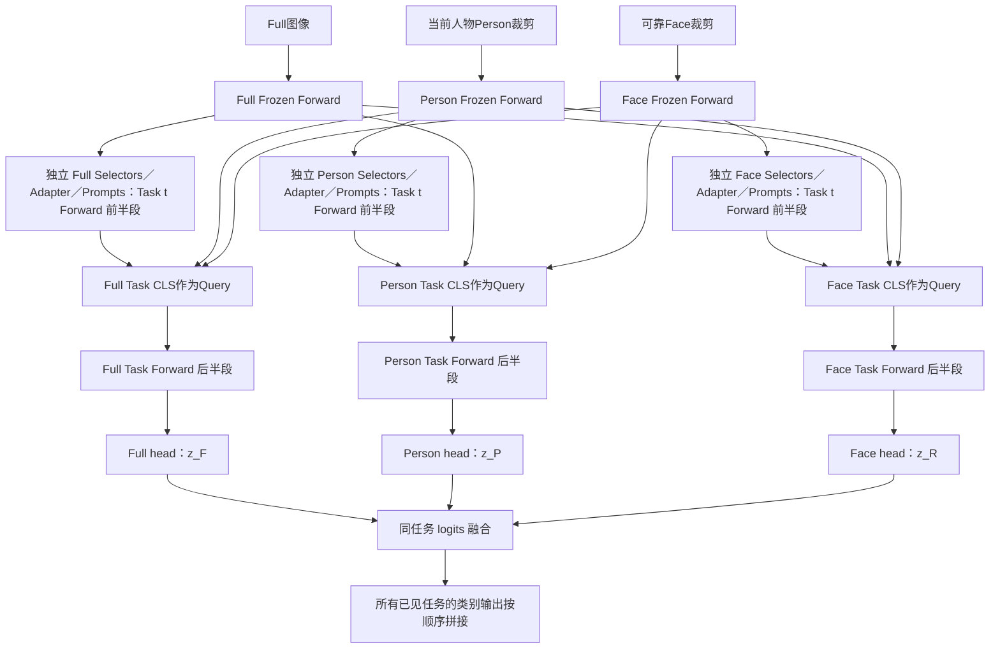

# 独立三视图 MULTI-LANE：以 Task CLS 为代理的跨视图交互与 logits 融合

日期：2026-11-01。状态：研究方案，未实现、未启动训练，尚无该结构的实验结果。

## 1. 这次要验证什么

用户希望把 CrossViT 的独立分支、CLS-agent 跨分支读取、各自分类头与末端 logits 融合迁移到三视图 MULTI-LANE。目标是在一个预先定义的训练流程中，学到互补的 Full／Person／Face 表示，不使用已训练 A、B 模型提供答案，不换入 B0 训练好的头，不在实验完成后拼装来源不同的路径。

这次的机制假设是：此前的限制可能同时来自共享任务适配参数、共同分类读出，以及摘要压缩后再交互。将这几个接口明确拆开，有机会让视图各自形成合适的表示，再通过本分支 Task CLS 主动读取其他视图的证据。这里提出的是候选解释，不宣称已有实验证明它一定能提升。

已有 33.6248／40.5129 的完整模型均值只能说明不同训练结果之间存在可利用的互补，不能证明独立三分支的共同训练一定能学到同样结果。此前独立 Selectors 的负结果只隔离了部分参数，没有验证三套 Adapter／Selectors／Prompts／heads 全部独立的结构。

历史强参照为 seed1 B0：Validation 最终／阶段平均 42.4628／49.4763；Test 最终／阶段平均 32.6800／39.5292。它是配方与效果参照，不是本方案安装进来的教师或分类头来源。

## 2. 与两篇论文的对应关系

CrossViT 使用独立分支，以本分支单个 CLS 作为 agent，读取另一分支的 patch tokens，在融合步更新本 CLS，之后继续分支编码；官方实现最后由各分支自己的 head 输出 logits 并取均值。其 K/V 包含投影后的自身 CLS 与对方 patch，不是只交换两个 CLS。[论文 §3.2–3.3](https://arxiv.org/html/2103.14899)、[官方实现](https://github.com/IBM/CrossViT/blob/main/models/crossvit.py)。

MULTI-LANE 通过 Frozen Forward、任务专属 Patch Selectors、Summarized Patches 和 Task Forward 学习任务表示，并在推理时计算所有已见任务路径，避免必须为整张多标签图片选出唯一任务。[论文 §3.3](https://arxiv.org/html/2405.15633v1#S3.SS3)。

本方案保留 MULTI-LANE 的任务隔离和摘要式任务计算，在同一增量任务的三个视图之间加入 CLS-agent 交互。它不是原 CrossViT 的逐项复现：输入是人物相关的三个 crop，ViT 保持冻结；交互首版只有一处；三视图扩展也需要自定义可靠性处理。

## 3. “独立分支”具体独立哪些参数

| 对象 | 首版安排 | 原因 |
| --- | --- | --- |
| Full／Person／Face 的 ViT，包括 embedding、位置编码、LN、MSA、FFN、原投影 | 三份独立参数对象，各自加载同一 CLIP ViT-B/16 预训练值，全部冻结 | 按用户要求先不共享；同时保留 MULTI-LANE 冻结骨干的前提 |
| 当前任务 Image-token Adapter | 三视图各自一套，b32、index1、scale0.03 | 辅助视图的 Adapter 更新不再直接改 Full Adapter |
| Patch Selectors | 每视图、每任务各10个 | 各自学习该视图的任务取证 |
| Prefix Prompts／任务专属可学习状态 | 每视图、每任务各自一套 | 各自适配 Task Forward |
| 新增 Cross-Attention | 每视图、每任务一个接收模块，Q/K/V/O 不与其他视图或任务绑定 | 允许三路采取不同的补充读取方式 |
| 分类头 | 每视图、每任务拥有当前类别的独立线性读出 | 不要求三路同一特征坐标必须由共同 W 解码 |

“三套独立 ViT”不等于解冻三套 ViT。三份同值且永远冻结的权重不会自行学出三种编码器，其输出差异来自输入，学习差异主要来自三套任务适配参数与交互模块。首版不解冻 backbone，否则会同时改变预训练保持、显存预算和增量任务保护，无法检验当前假设。

冻结的 MSA／FFN 在每条 Task Forward 中仍参与计算，但不进行视图专属全参数微调。不得将本方案写成“与 CrossViT 一样从头训练三个独立 Transformer”。

八任务时有24组视图－任务适配参数、24个接收交互模块、24个任务级 head。若实现为每视图一个全类别 head，则三个 head 内部都必须按任务类别块冻结，语义上与24个任务 head 对应。

## 4. 总体数据流

图中其他 Frozen Forward 到 CLS 的线代表“作为该接收模块的 K/V 证据”，不是把它们送入其他分支的原 Frozen Forward。交互不向冻结图像流写回。

## 5. 局部 Task Forward 与交互位置

三路先各自完成第1–6层的本地计算。每层继续遵循：本视图图像证据 → 本视图任务 Selectors 的 Summarize → Summarized Patches 与 Task CLS 进行原 MSA／Prefix-Tuning → Drop & Replace → 原 FFN。

在第6层（index5）完整本地任务块之后、进入第7层之前插入一次交互。此时得到三个本地 Task CLS，以及三路 Frozen Forward 对应深度的图像 patch tokens。第6层只是本轮预先锁定的中间位置，不借用此前 MoE 层消融宣称它是新结构最优层。

接收分支的 Query 是刚形成的、包含本图内容的 Task CLS，不是原来10个任务 Selectors，也不是10份 Person 摘要。每个 Query 只有1个 token。三个接收模块都从同一时刻的交互前状态计算，之后同时写回，避免 Full 先更新再被 Person 读取形成顺序偏差。

交互只更新本分支 CLS，原 Selectors 与 Frozen Forward 的 patch tokens 不被该步改写。更新后的 CLS 带着补充信息进入第7–12层的原 Task Forward。

与 CrossViT 的一处重要差异是：CrossViT 后续分支 encoder 可让更新的 CLS 再影响本分支 patch；本方案的 Frozen Forward 永远不接受 Task CLS 回写。新信息在任务专属 CLS／任务状态中传播，不能声称它重编码了冻结图像 patch。

## 6. 首版 Q、K、V 的明确接口

设 c_{t,v} 为第6层本地任务块完成后的 CLS，P_v 为同深度 Frozen Forward 的空间 patch tokens（去掉 frozen image CLS），v属于Full、Person、Face。

以 Person 接收模块为例：

    Q_P = LN(c_{t,P}) W^Q_{t,P}
    M_P = [c_{t,P}; P_F + e_{t,P←F}; P_R + e_{t,P←R}]
    K_P = LN(M_P) W^K_{t,P}
    V_P = LN(M_P) W^V_{t,P}
    c'_{t,P} = c_{t,P} + MCA(Q_P, K_P, V_P)

e 是仅用于区分两个外来视图来源的可学习类型嵌入，由接收模块私有；不提供人物框监督，不是新增路由器。自身 CLS 作为 memory 第一个 token，与 CrossViT 接口保持对应。

另外两路为：

| 接收分支 | Q | 外部 K/V 来源 | 写回 |
| --- | --- | --- | --- |
| Full | Full Task CLS | 当前人物 Person patch ＋可靠 Face patch | Full Task CLS |
| Person | Person Task CLS | Full patch ＋可靠 Face patch | Person Task CLS |
| Face | Face Task CLS | Full patch ＋Person patch | Face Task CLS，仅可靠Face行 |

这是“每个接收分支一个模块、共同读取两个其他视图”的三视图扩展，不是官方两分支结构的原封不动搬运。共3个接收模块，包含6条有向信息通路，不是6个独立 Attention 模块。

首版使用空间 patch 作为外部证据，不先压缩为10份 Summarized Patches。原因是之前已经反复测试压缩后再组合，本轮希望检验单 CLS 能否直接选择压缩前的补充证据。原 Selectors 和本地 Summarize 保留；只是新增交互从另一接口读取证据。

这些 patch 来自冻结图像流，不经过对方可训练 Adapter／Selectors／Prompts，因此当前首版的 K/V 来源不会把接收损失反向传播到对方任务适配参数。Q、K、V、O 的投影仍正常学习，接收 CLS 对本分支早期任务参数仍可导。以后如改用可训练 Summarized Patches，必须重新审计跨分支梯度，不能沿用本结论。

建议768维任务状态、Attention内部64维、4头、无额外CA后FFN；输出投影零初始化。没有后置1%修正上限，也不额外叠内容门控、区域限制、条件MLP或MoE。后续所有候选使用同一残差形式；记录实际更新／CLS范数和分类投影，不提前预设幅度一定合适。

224输入、patch16时每视图196个空间patch，Face可靠时每个接收模块约1对393个tokens做读取；Face不可用时Full／Person约1对197。注意力图是单Query线性读取，完整训练成本仍含三路 ViT、Task Forward 以及每任务K/V投影。

## 7. 每个分支独立读出，最后融合 logits

三路 Task Forward 完成后继续原最终投影和各自特征归一化：

    z_{t,F}=H_{t,F}(h_{t,F})
    z_{t,P}=H_{t,P}(h_{t,P})
    z_{t,R}=H_{t,R}(h_{t,R})

每个 head 输出同一任务的同一批类别，具有相同类别顺序，但 W／bias 各自学习。首选 CrossViT 式有效视图 logits 均值：

    z_t=(z_{t,F}+z_{t,P}+r*z_{t,R})/(2+r)

r 为已有可靠Face布尔mask；随后对融合 logits 做 sigmoid。它不是三路 sigmoid 概率均值，不是按样本挑一个最强分支。

同时预先保留历史权重控制：可靠Face时0.64zF+0.16zP+0.20zR，否则0.80zF+0.20zP。因为原三路质量不等，均值会同时降低Full权重、提高辅助视图权重，不能将这一变化混入 Attention 的解释。

共享同一个线性头且权重和为1时，特征加权与 logits 加权在实数运算中等价。因此本轮有意义的变化是独立任务参数、独立 head 和 CLS-agent 交互，不是单独把求和位置移动到分类头之后。

## 8. 一个模型怎样共同训练

每个任务按30epoch一次共同训练三个当前任务分支及其交互模块，使用同一批成组人物数据。不先训练三个单视图模型再安装模块；不加载已训练A／B／B0 head；只加载标准CLIP预训练。

沿用强底座的监督职责：

    模型目标：BCE(融合logits) + 0.1 * mean_valid_views[BCE(本视图logits)]
    Adapter目标：ASL(融合logits) + 0.1 * mean_valid_views[ASL(本视图logits)]

Adapter-ASL仍是参数梯度路由，不将两项目标直接相加后更新全部参数。Adapter仅接收原ASL路线，Selectors／Prompts／CA／heads按原BCE路线学习；ASL可经head和CA传播到Adapter，但不以ASL更新head和CA。沿用历史legacy_full_zero的标签构造／loss归一化，不擅自改成current_only。

Face辅助监督只对可靠Face行计算，沿用原有效视图损失聚合；整batch没有可靠Face时Face辅助目标和Face接收模块无更新。不可靠Face从所有接收模块的softmax memory中剔除，其分支也不进入最终融合；不是只把V置零而保留其分母影响。

独立参数去掉的是“Face loss直接更新同一份Full Adapter／Selector／Prompt”的通路，不是取消共同学习。融合BCE的梯度仍取决于三路共同预测，Full也可能学成分工中的某一部分；Full接收Person／Face后前向函数本身还会变化。不能保证Full单路mAP保持不变，也不要求三路独立mAP全部提高才算融合有效。

## 9. 增量任务保护与测试

当前任务t只更新t对应的三路任务参数、交互模块与类别head。任务结束整体封存；所有旧任务可访问的Adapter／Selector／Prompt／CA／head／视图类型嵌入及可学习Norm、bias、scale都必须冻结。Frozen ViT始终冻结。

交互严格局限于同一任务：Full任务t只读取该任务对应结构定义的其他视图证据，不读取正在训练的任务u的摘要或CLS。不使用跨任务公共可训练交互器。

测试时三路Frozen Forward各执行一次，所有已见任务各执行三路Task Forward及自己的交互／head，任务内先融合logits，再按类别顺序拼接全部任务输出。没有选择最佳Task Forward、没有Task Router、没有DDAS，也不比较哪个任务预测更好再取它。

由于旧任务的全部可训练依赖冻结，且外部patch来自冻结图像流，新任务学习不应改变固定输入的旧任务logits；需真实前向校验，而非只看requires_grad。

## 10. 最小正式对照矩阵

| 组别 | 参数与head | 交互 | 融合方式 | 要回答的问题 |
| --- | --- | --- | --- | --- |
| B0 | 历史共享任务参数、共同head | 无 | 历史特征权重 | 32.6800／39.5292强参照，优先重放已有checkpoint |
| I-W | 三套独立任务参数与heads | 无 | 历史logits权重 | 独立分支与独立读出这一整套基础结构是否有效 |
| I-M | 与I-W相同 | 无 | 有效视图logits均值 | 单独改变融合权重的影响 |
| C-W | 三套独立任务参数与heads | CLS读取对方patch | 历史logits权重 | 同权重下Attention相对I-W的收益 |
| C-M | 与C-W相同 | 同一CLS跨分支读取 | 有效视图logits均值 | 主候选；对比I-M判断Attention净价值 |
| P-M | 与C-M相同 | 相同patch及条件输入的Pool-MLP | 有效视图logits均值 | 动态Attention是否优于普通内容组合 |

首次正式比较为五组新增训练，加一个已有B0重放参照。五组均完整8任务，不只看task0–2。I-W与B0同时改变分支任务参数和heads，不能把差值唯一归因于其中之一；如果基础结构有收益，再做头共享／独立的专门控制。

Pool控制读取完全相同的空间patch、可靠性mask和本分支CLS：分别对外来视图经Value投影后池化，再连同本CLS送入MLP，输出同位置CLS残差。其参数预算接近CA，精确数量在实现前核算，不以读取最终CLS的旧MLP冒充同输入控制。

只有主结构出现收益或需要解释压缩断点时，再加一组其他设置相同、但K/V改为停止梯度的原Summarized Patches的CA控制。它用于区分原始patch访问与摘要访问，不能与梯度是否传给来源Selectors同时变化。

## 11. 训练与评估配方

| 项目 | 预先固定配置 |
| --- | --- |
| 数据 | 原EMOTIC 26类、8任务[5,3,3,3,3,3,3,3]，原Train／Val／Test与人物／Face清单 |
| 首轮seed | seed1，与32.6800历史强底座一致；后续有效配置再扩seed，首轮不混seed比较 |
| 骨干 | 三份独立冻结CLIP ViT-B/16，输入分辨率与patch大小保持原配方 |
| Image-token Adapter | 每视图每任务独立b32／index1／scale0.03／ReLU，跨任务独立初始化 |
| Task Forward | 每视图每任务10 Selectors，原Prefix Prompts及Drop & Replace，原12层 |
| 新交互 | 第6层本地块结束后一次，3个接收模块／任务，内部64维／4头，零输出初始化，无额外FFN |
| 训练预算 | 每任务30epoch，batch64，Adam／WD0，每任务重置optimizer，原cosine／min0／无额外warmup |
| 学习率 | Selectors／Prompts／当前head 0.0125；Adapter／CA或Pool 0.0004；新视图类型嵌入跟随交互组 |
| 监督 | 原融合与aux BCE0.1、Adapter-ASL neg9.8／pos0／clip0.05、legacy_full_zero |
| 增强／Face | 原成组输入，Person颜色扰动关闭，可靠性valid／nonambiguous／min24／score0.6不调阈值 |
| 历史随机流 | 保留原72线程初始化／训练环境、AMP／TF32／scaler与原采样流；新模块独立RNG，不能扰动I-W／I-M公共初始化和batch |
| 对照初始化 | 同一个seed各新组的三套基础任务参数／heads逐值相同；分支之间参数对象独立，可从同一未训练初值复制以控制随机性；不是复制已训练模型 |
| 评估 | 历史samples_intersect_seen_classes；8阶段mAP算术平均；Val与Test均报告最终和阶段平均，含原逐类／逐视图与cF1／oF1 |
| GPU | 未来如获执行指令，仅GPU0；测单作业峰值后按显存、CPU／共享内存吞吐自适应并发，不凭空承诺全部同时启动 |

各新组共享相同增强后的三视图样本与class顺序。I-W与C-W、I-M与C-M的公共初始参数应逐值匹配，C组输出为零时必须重放相应I组，而不是拿所有新组的OFF去要求等于旧共享B0。

目录拟为 ./output/crossvit_independent_three_view/<run_id>/<arm> 和 ./logs/crossvit_independent_three_view/<run_id>。训练入口与恢复字段目前尚未实现，不提供伪装成已可运行的命令。未来执行前再声明源码分支、实际入口、数据与预训练路径，并先完成smoke与成本测量。

## 12. 机制验证应随正式结果一起报告

1. **实现一致性**：检查参数对象与存储无跨视图别名；初始化零CA重放同结构无CA；所有旧任务固定输入的logits不漂移；可靠性缺失不进入attention分母。
2. **实际内容读取**：记录三路CLS更新范数、读取各视图的权重、head投影变化与逐类排序，不以注意力图好看作为成功。
3. **推理条件贡献**：task0／2／6／7的Validation／Test分别关闭整套CA、屏蔽一个外来视图；OFF模型仍保留共训参数，不等于从头训练的I组。
4. **人物对应**：固定接收CLS，只交换外部Person／可靠Face证据，比较同图多人中原始目标与他人；按可见性、面积、重叠分组，固定规则，不用Test挑供体。
5. **语义与读出**：保存各自head下的Full／Person／可靠Face AP，以及融合AP；独立heads的特征不直接做跨视图均值，避免重新引入共同坐标假设。
6. **成本**：报告可训练参数、冻结参数存储、每任务增量、真实峰值显存与整8任务吞吐。三份ViT权重增加存储，但旧三视图本来已需要三个输入forward，不能直接说骨干FLOPs从一份变为三倍；新增成本还含任务参数与跨patch投影。

前三任务结果不代替完整八阶段。重点保留task6与Sadness／Sensitivity／Suffering的逐类AP；Test已参与长期探索，报告全部预声明组，不将最优结果称为未触及的独立测试。

## 13. 如何解释可能的结果

| 结果 | 能支持的结论 |
| --- | --- |
| I-W优于B0，C-W不再提高 | 独立适配／独立读出有价值，但未证明Attention增加价值 |
| I-M下降，I-W正常 | 辅助视图均权是问题来源，不能据此否定独立分支或Attention |
| C-M优于I-M，C-W也优于I-W，且均超过强参照 | 支持CLS跨视图交互能在独立表示上增加有用证据 |
| C-M与P-M相当 | 新接口／更多证据可能有用，不能把全部收益归给动态Attention |
| CA关闭有益、正确证据不优于错配 | 交互残差或人物对应仍失败，不继续简单加层／扩宽 |
| Face单路上涨但融合不涨 | 辅助视图的能力仍未形成排序互补，需要看错误相关与各head尺度，不自动提高Face权重 |
| 早期收益、task6／7下降 | 首轮不能判成功，检查类别与任务读出，不按Test挑最好中间epoch替代最终 |

主成功标准是C组同时提高Test最终和阶段平均，并在同权重下超过无交互I组；若还超过同输入Pool，且正确人物证据稳定优于错配，才更有依据将机制概括为有效的跨视图Attention。B0与已有CLS-MLP始终保留为强参照，完整模型均值仅作为不同训练来源互补的经验对照，不是单模型必须达到的理论上界。

## 14. 给导师的简述

原模型让三视图使用同一套任务适配参数和共同分类读出；新增视图能力可能伴随共同表示的改变。本方案借鉴CrossViT，让三视图保有独立的任务表示与分类头，再以各自Task CLS为代理，从其他视图的冻结图像patch中主动读取补充证据。读取结果进入本分支后续Task Forward，最后只在统一类别空间融合logits。MULTI-LANE继续负责跨任务隔离，新增交互只负责同一任务内的三视图互补。实验先区分独立分支、融合权重和交互本身的贡献，不预先把更复杂的结构等同于更好的效果。
