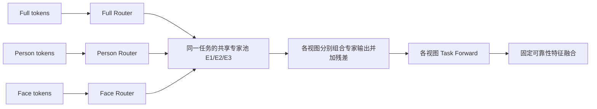

# MoE-Adapters 迁移到 MULTI-LANE 三视图：可行性分析

日期：2026-10-15。范围：论文、官方实现、当前代码与已有实验的可行性分析。已新建分析分支；本轮没有修改业务代码、训练配置或启动实验。

**同日追问修正：** 用户要求按独立MoE-Adapters方法分析尽量完整迁移。见[结构定位与整体迁移补充](moe_adapters_full_transfer_and_multilane_location_20261015.md)：本文下述索引1/每任务独立池是上一轮保守候选，不是原法完整迁移；当前主要候选改为Task Forward FFN并联、每层跨视图/跨任务共享专家池及原法式activate-freeze，并独立分析文本/DDAS/多标签接口冲突。本文保留作为初次方案和已有结果来源记录。

## 1. 判断

**工程上可行，值得作为受控的动态路由候选；当前证据不足以预期它会提高精度。** 最有意义的新问题是：在共享完整 Adapter 专家池的前提下，Full、Person、Face 能否根据各自图片内容选择不同的专家组合，得到比固定重叠路由更好的新任务泛化和融合收益。

建议分两步研究：先验证同一任务内的跨视图共享和动态路由，再考虑跨任务旧专家复用。两者同时引入，会难以区分路由、专家质量、容量增长和旧路径变化的影响。此前静态 MoE 和后置旧函数复用的负结果必须作为约束，不能把本候选描述成尚未探索过的全新 MoE 方向。

这里的“共享参数融合”是多个视图复用同一套专家参数，并组合各专家的完整输出。它不直接合并三个视图的特征，也不先把不同专家的 down/up 参数分别平均；最终三视图特征融合仍由现有模块负责。

## 2. 从论文借鉴什么

[CVPR 2024 论文，第 3.3–3.4 节](https://arxiv.org/html/2403.11549v2#S3.SS3)的核心是：冻结 CLIP；每层配置完整 Adapter 专家池；任务相关 Router 用 CLS 做 Top-k 输出加权；任务后冻结高频专家；DDAS 推断任务/分布并选择路径。论文配置为 22 个专家、Top-2，图像和文本两侧的专家参数分别保存。

[官方 CVPR 版本代码](https://github.com/JiazuoYu/MoE-Adapters4CL/tree/1fe7fb99e56b9d7a1d41f0b475a0ac626e6f3885)已重新只读核对：`mtil/clip/model.py` 中按任务保存 router/noise，训练时可使用 noisy Top-k；`mtil/src/models/finetune.py` 用累计名单冻结专家，并在结束时按层统计图像/文本 Top-2。仓库另有 MoE-Adapters++ 和 CIL 入口，不能混用版本或默认各入口冻结策略相同。

迁移时保留“完整输出专家 + 条件路由 + 冻结复用”思想即可。22 专家、双编码器全层插入、DDAS、原分类损失均不是本项目必须照搬的设置。原论文效果不构成 EMOTIC 三视图多标签增量学习的性能保证。

## 3. 与当前代码的对应关系

当前业务基点为 `25fc8617b20f60e96ee57a7b4a4827e048014501`。

| 当前组件 | 源码位置 | 迁移含义 |
| --- | --- | --- |
| 共享冻结 CLIP 图像主干 | `multi_lane/track_a/model.py::_encode_single_lanes` | 保留原 Frozen Forward；三张裁剪各自提取 token，权重共享不等于三路只做一次前向 |
| Selector 图像证据读取 | `model.py::_lane_block` | 已有 Image-token Adapter 接口，可返回 `[task,batch,token,width]` 的任务专属证据 |
| 按任务激活/恢复模块 | `model.py::activate_task/restore_task`、`adapter.py` | 可扩展 Router、expert mask、封存元数据的生命周期 |
| 三视图最终融合 | `view_fusion.py::TaskwiseViewFusion` | 首版保持可靠 Face 权重 .64/.16/.20，否则 .80/.20/0 |
| 推理按类别所属 lane 汇总 | `model.py::seen_logits_with_views` | 对全部已见 lane 应用各自 Router，无需测试图片的真实任务标签 |
| 原 ParaX 参数组合 | `adapter.py::ParaXImageAdapterBank.forward` | 不直接改名为 MoE-Adapters；它分别混合 A/B 后再投影，与完整专家输出组合一般不等价 |

静态专家实现位于另一已存在的本地工作树：`three-view-static-moe/multi-lane-main/multi_lane/track_a/static_moe.py`，分支 `exp/static-moe-key-value-diagnostic-20261013`、HEAD `a74cf6f`。本新分支从当前主工作区已提交 HEAD 建立，尚未包含该支线的静态 MoE 源码；实施时需要审阅并迁移最小依赖，不能假设它已在本分支中，也不应整条支线盲目合并。

当前代码按任务分配 Selector/Prompt/分类参数，同时在视图之间共享。只改 Adapter 专家池不会解除这些共享关系。若瓶颈来自这些组件，动态专家 Router 可能仍没有收益；现在没有证据把它们判定为根因。

## 4. 建议的首版结构

首版沿用历史静态 MoE 的位置：**Task Forward 在索引 1（第 2 个 block）读取图像证据时，适配 `block.ln_1(image_tokens)`，同时供 Selector 的匹配和聚合使用。** 适配结果不写回 Frozen Forward。这样可优先隔离路由变化，而不同时改变插入位置。

这和原论文在 Transformer 注意力输出后、与 FFN 并行插入专家不同，属于适应 MULTI-LANE 结构的迁移，不是原样复现。更接近原论文的 Task-lane FFN 并行专家也可实现，但应作为后续独立的位置对照；不首轮同时修改两处，更不直接写入持续更新的共享图像流。

每个任务 t、选定层 l 拥有一个共享专家池，三个视图 v 使用三个小 Router：

```text
h[v,l] = Frozen Forward 在该层供 Selector 读取的 ln1 图像 tokens
c[v,l] = h[v,l] 的 CLS
g[t,v,l](x) = softmax(top2(R[t,v,l](c[v,l])))
delta[t,v,l] = sum_e g[t,v,l,e](x) * E[t,l,e](h[v,l])
h_adapt[t,v,l] = h[v,l] + Bound(scale * delta[t,v,l], h[v,l])
```

E 为完整 down→ReLU→up 专家。每张图片选出的权重用于该视图全部 token；不是逐 patch Router。三个视图输入不同，专家处理各自 token，不把 Full 的第 i 个 patch 与 Face 的第 i 个 patch 直接对齐。



Router 首选三个独立线性映射，明确提供不同的视图决策函数；这是对论文任务 Router 增加视图维度的设计。共享 Router 因输入不同也能给出不同 gate，但不等于显式提供了视图专属规则，应作为必要对照。共享 Router 加 view embedding 是另一参数化选择，不首版同时引入。

以上选择用冻结图像 CLS 作描述符，有现成输入且便于保护旧路径。索引 1 的 CLS 语义可能较弱，是否足以支持内容路由是待验证风险。改用 task CLS 需要明确接口与梯度路径，且引入任务表示依赖；不能在比较中无记录地更换。冻结 Router 参数后仍会因不同图片产生不同 gate，它依然是动态路由。

视图 Router 不应被强行训练成三种完全不重叠的路由。不同视图在某些图片上复用同一专家可能是正确行为；专家编号也不会自动对应“场景/身体/表情”。

### 参数和计算预算

沿用当前静态实现的预算例子：d=768、3 个 b16 专家、一个池共享输出 bias。专家参数为 `3*(2*768*16+16)+768 = 74,544/task/layer`。每个带 bias 的线性 Router 为 `768*3+3=2,307`；三视图 Router 合计 6,921，新增总计 **81,465/task/layer**。八任务、单层合计 651,720，未含已有 Selector/Prompt/head。

这是实施候选的精确张量预算例子，尚非启动配置。如果加入 noise 网络、Norm、可学习 scale 或改变 bias 结构，必须重算。静态 b48/3×b16 的历史预算是 74,544，不能说动态版与它完全等参。

Top-2 每路激活宽度 32，不能只和 b48 普通 Adapter 比较并把差异全部归因于路由；需报告总参数、活跃参数和实际 FLOPs，保留 b32 有效宽度控制。最初可计算全部三个专家再加权以简化审计；只有实际稀疏 dispatch 后才可声称减少专家计算，三路主干计算仍保留。

## 5. 增量学习需要额外保护什么

首版每任务独立池，只在该任务内跨视图共享。任务结束后整体冻结池、三个 Router、scale/bias/Norm 和相关状态，旧 Selector/Prompt/head 也按既有机制保护。它验证跨视图共享，**不声称实现跨任务知识迁移**。

如果后续研究跨任务复用，可让新任务访问冻结旧专家并训练少量新专家及自己的三个 Router，保留论文所强调的“旧旧/旧新/新新”组合。必须同时满足：

1. 旧任务可以访问的全部专家保持不变；只冻结平均激活最多的两位不足以严格保护旧函数。
2. 保存旧 Router 的输出空间和 eligible mask。扩池不把新专家加入旧任务 softmax 分母，也不让旧路径访问未来专家。
3. 专家完整函数、共享输出 bias、Norm、投影、残差界/scale 和输入流均保护。冻结 A/B 而更新共享 Norm 或输入仍会改变旧预测。
4. 冻结专家仍参与前向，不能因 `requires_grad=False` 就把其输出整体 detach，阻断当前 Router 应有的梯度。
5. checkpoint 保存全部已见旧专家和 mask；不能只保存当前可训练参数。当前 compact 导出排除冻结 visual 的假设，也需随插入位置重新审查。

固定有限池并严格冻结所有旧任务可访问专家，可能很快耗尽可学习容量；逐任务加专家又会增长存储与推理成本。这是设计权衡，不是一个冻结开关可以同时解决。

**DDAS 首版不移植。** Full/Person/Face 身份是已知输入元数据；EMOTIC 同一图片可能同时有多个任务的情绪类别，不能假设每图只有一个真实任务。现有 MULTI-LANE 对全部已见 lane 前向并按类别归属汇总，能使用各任务的 Router；以图像分布挑唯一 lane 反而可能丢失其他有效标签。若将来单独研究未知域或零样本，需要另定义协议再讨论 DDAS。

无可靠 Face 时沿用原融合与辅助监督 mask；路由统计、负载损失和任何新增 Face 监督也应排除无效样本，避免替代裁剪占用专家容量。

## 6. 已有结果如何约束本候选

以下数字均来自主工作区已保存的报告，本轮没有重新执行推理或核验服务器状态；不同实验不互换基线。

| 已有配对八任务结果 | 最终 val mAP | 最终 test mAP | 含义 |
| --- | ---: | ---: | --- |
| 静态 MoE 同批 B0，seed0 | 42.1912 | 32.0610 | 本表参照 |
| 普通共享 b48，无界 | 42.2920 | 31.7608 | 增加 Adapter 容量没有自动获益 |
| 三专家均匀输出混合，无界 | 41.9965 | 31.3354 | 不能用 MoE 名称保证共享有效 |
| 三视图两两重叠输出混合，无界 | 42.7858 | 31.9202 | 优于均匀，但 test 仍未超过 B0 |
| 重叠输出混合，ρ=.1 | 42.0629 | 32.0727 | test 仅约 +.012 点，前七阶段均低于 B0；没有稳定收益证据 |

旧路径审计与 FP32 固定人物检查已通过，静态方案在 task0 就存在 test 损失。因此该支线的主要问题不能继续笼统归因于后续任务遗忘。

固定 checkpoint 的 validation key/value 分离中，value-only 没有超过原 key+value：重叠 v1 为 42.7546 对 42.7858，v2 为 42.0580 对 42.0629。没有依据把新动态版直接改成 value-only 并宣称已定位原因。

另一个不同位置的后置旧完整函数复用实验，三 seed 最终 val 均值为基线 42.6979、只组合旧功能 42.6780、新专家供体 42.3597。它说明“冻结成功”与“专家具有可迁移判别力”是两件事；不直接否定新位置的动态 Router，但降低了直接堆叠跨任务复用的优先级。

因此新增的可检验假设只有：**内容相关、视图条件的路由能否改善当前专家的分配与泛化。** 参数共享一定导致梯度冲突、动态路由一定能消除冲突、输出去相关就证明语义分工，这些说法目前都不成立。

## 7. 最小验证路线（建议，未执行）

先锁定 EMOTIC 八任务协议、插入位置、输入描述符、专家数/宽度、残差映射、既有 BCE 与辅助监督、固定融合、轮次和配对 seed。保持这些因素后比较：

| 对照 | 用途 |
| --- | --- |
| B0 无 Adapter | 判断净收益 |
| 普通共享 Adapter，b48；另报告 b32 控制 | 区分总容量与单视图有效宽度 |
| 3×b16、固定重叠路由 | 静态共享参照 |
| 3×b16、三路相同的任务可学习常量路由 | 区分单纯系数学习与图片条件化 |
| 3×b16、每视图一组任务可学习常量路由 | 区分视图规则学习与动态内容选择 |
| 3×b16、共享动态 Router | 判断图片条件化本身的作用 |
| 3×b16、三视图动态 Router | 主候选；与上一组比较视图专属规则 |

可按阶段开展这些对照，无需一次铺开。主候选首先与 B0/同专家预算静态重叠比较；出现可重复的 validation 信号后，再用两种常量路由与共享动态 Router 解释收益。不同 Router 的参数量需逐组报告；若结论只建立在数千参数的小差异上，补预算敏感性检查后再归因。

实现预检需覆盖：零 up 初始化的完整模型 identity、当前任务专家/Router 非零有限梯度、旧参数和 mask 不变、checkpoint 重放、Face mask、所有 lane 推理与未来专家隔离。零输出初始化会令第一步 Router 梯度为零，不能误判为永久断梯度；需在专家已有非零输出后检查。Top-1 softmax 的选中权重恒为 1，不适合作为初版可微权重学习方案。

Top-2 若完全零 logits、确定性 tie-break，可能让各视图一直命中同一对专家。需要在正式计划中预先锁定可探索的初始化或独立 RNG 的训练噪声，避免改变基线采样 RNG；推理关闭噪声。不要为了让三个路由看起来不同而直接增加强制互斥损失。任何负载正则应显式接入损失并记录梯度，不能因官方代码中计算了一个诊断项就默认训练入口已使用它。

评价记录最终/阶段平均 mAP、各路及可靠 Face 指标、融合相对 Full 的收益、新旧类 AP、FP32 旧 logits 漂移、逐视图 gate/专家使用率、残差范数和专家输出相关。梯度冲突只在共享专家的相同参数坐标上计算。路由差异本身不是成功标准；主候选应优于同位置对照，并在配对 seed 中复现，不能只靠单 seed 极小 test 差值。

新训练的学习率、batch、epoch、seed、optimizer/scheduler、checkpoint 和实际路径仍待完整计划声明；本分析不构成实验启动配置。本轮没有训练入口可供直接执行。正式产物使用 `./logs/`、`./output/`，运行与测试在远程 Linux；参数选择不使用 test 反复搜索。

## 8. 本轮 Git 与证据记录

- 新分支：`codex/moe-adapters-three-view-20261015`，HEAD `25fc8617b20f60e96ee57a7b4a4827e048014501`，尚无 upstream、未 commit/push。
- 新独立工作树：`/Users/denghaoyuan/.codex/worktrees/moe-adapters-three-view-20261015/multi-lane-main`。从主工作区已提交 HEAD 建立；未复制主工作区未提交内容。
- 主工作区保持 `exp/parax-protected-eight-task-evaluation`；创建前已检查全部九个现有本地 worktree 状态。未连接或修改服务器主/test-only/其他工作树。
- 基点携带的三个上下文文件停留在较早历史，本轮只新增本方向的最新状态，旧章节不作为当前实验队列指令。已阅读主工作区 2026-10-13 的相关结果，结论摘录于本报告。
- 本轮只新增本报告并更新三个上下文文档，静态检查后保留未提交状态；用户本轮要求为先分析，未启动实验或请求提交推送。

本地结果来源位于原主工作区的 `docs/`。以下 SHA256 固定本轮实际读取的报告版本；这些尚未提交的原文件没有被导入本新工作树：

| 来源文件 | SHA256 |
| --- | --- |
| `static_moe_v1_complete_results_analysis_20261012.md` | `677630670b59b4111024a6836738a7f0c4d107b1b775db0db01454db417ca707` |
| `static_moe_v2_complete_results_analysis_20261013.md` | `5ed41cdfd2abae86db207c4d9af3c2bbc777f9498be8f03bae762105e88d8add` |
| `static_moe_key_value_diagnostic_results_20261013.md` | `d82639280aef417bd47065f835683aa53c48e5ea4e8e8f38b4884adc4427b2e4` |
| `old_function_three_seed_validation_results_20261013.md` | `904dd369c852a0224ebb15a97c9543e0f8db1442e66791acbb1492cf421a7295` |
