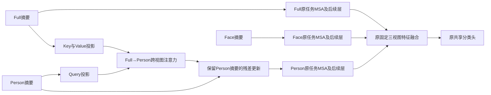

# 保留三路Task Forward的目标人物条件跨视图注意力：可行性与详细计划

日期：2026-10-21。状态：仅计划，尚未实现、未启动实验。
用户要求先分析可行性并用论文术语解释，本轮只新增本文并更新三个上下文文档。
业务代码、配置、训练脚本、checkpoint、服务器工作树均不修改；不提交或推送、不创建实现分支。

## 1. 要回答的研究问题

现有三视图模型分别读取Full、Person、Face，在任务表示形成后进行固定融合。
我们要验证：让Person的Summarized Patches提出查询、从Full的Summarized Patches选择信息，是否能学到更有用的目标人物条件场景证据。

用导师容易理解的语言：任务Selectors告诉模型“本任务关心什么情绪线索”，Person摘要进一步告诉模型“现在要判断的是哪个人的状态”，Full为该人提供可供检索的场景信息。
这是待检验的机制假设。现有失败结果没有证明人物关联不充分就是唯一根因，也没有证明cross-attention一定能纠正它。

首版只增加一条Full→Person的信息通路；三视图输入、三条Task Forward、固定末端融合、共享分类头和任务级冻结继续保留。

## 2. 论文依据与方向约定

MulT：Multimodal Transformer for Unaligned Multimodal Language Sequences，ACL2019。
原文：https://aclanthology.org/P19-1656/
方法：https://arxiv.org/html/1906.00295v1
官方实现：https://github.com/yaohungt/Multimodal-Transformer

借鉴Directional Pairwise Crossmodal Attention：接收信息的target提供Query，提供信息的source提供Key/Value。
因此本项目target=Person、source=Full，按论文信息流向记作Full→Person，或Person←Full。
“Person提出查询”不意味着信息从Person流向Full。

完整MulT还包含时间卷积、位置编码、多层crossmodal transformer、FFN以及多个方向的交互。
本候选只迁移其定向跨序列读取机制，并在任务摘要之间使用；不是完整MulT复现。
原文处理时间序列未对齐，本项目是同一原图嵌套裁剪的内容不对应，二者不同，不能直接套用原论文效果。

MULTI-LANE：Less is more: Summarizing Patch Tokens for efficient Multi-Label Class-Incremental Learning。
https://arxiv.org/html/2405.15633v1

沿用Frozen Forward、Task Forward、Patch Selectors、Summarized Patches、Prefix-Tuning和Drop & Replace。
新增模块放在已经得到Summarized Patches之后、原任务MSA之前，属于Task Forward内部的摘要交互。

## 3. 为什么值得验证，以及已有实验排除了什么

- 旧MoE已出现随图片变化的路由和非零专家输出，不能继续默认问题只是“路由没有动”或“专家没训练”。
- 联合MLP/MoE看过三路证据，但未胜固定融合，说明自由改写三路证据没有建立净收益；它不等于没有建模任何跨视图关系。
- 三组摘要交给一个CLS的retained先导也没有一致优势；这不排除保留三路状态的定向交互。
- 人物框/Person条件query-delta、后置校准、Face专用预训练替换等已有负结果，不将这些路线重新命名为本方法。
- 新候选的实际变量是：为每个Person摘要，以内容相关的方式选择Full摘要的Value；其归纳偏置比“统一query偏移”或“拼接后MLP改写”更明确。

近期匹配先导（seed0、task0–2、aux0、90/10原图holdout）完整validation：

| 方法 | 最终mAP | 三阶段平均mAP |
|---|---:|---:|
| 原三路路径aux0 | 44.3003 | 52.0944 |
| 单路径固定摘要 | 44.6137 | 52.5977 |
| 单路径三组摘要 | 43.8444 | 52.1276 |

本计划不使用历史test选择超参数，也不把上述三任务结果与八任务最终mAP混比。

## 4. 当前前向与接入点

同一套冻结CLIP权重分别计算Full、Person、Face图像流；不是三套独立可训练backbone。
每任务三视图共享Selector/Prompt参数，但拥有三个随图像演化的CLS状态。

在第l层，三个视图各自执行：

Frozen图像tokens + 当前任务Patch Selectors → Summarize → [Task CLS; Summarized Patches] → Prefix-Tuned MSA → Drop & Replace → 原FFN。

首版只在l=5（零起始索引，第6层）插入一次交互：

其他11层按原三路路径计算。选择第6层只是预先控制规模、保留后续整合空间的实现决定；旧MoE的Middle结果不能证明本模块最佳层数。
不同时搜索Early/Middle/Late，不增加双向交互、Face交互、MoE、MBT持久token或CCIM。

## 5. 模块的具体定义

记当前任务t、第l层的Full/Person摘要分别为 G_F、G_P ∈ R^(M×D)，M=10、D=768。
先分别做无仿射参数的逐token LayerNorm：N_F=LN0(G_F)，N_P=LN0(G_P)。

候选使用四头attention，总内部宽度r=64，每头d_h=16：

Q=N_P W_Q；K=N_F W_K；V=N_F W_V。
每头 A_h=softmax(Q_h K_h^T / sqrt(16))，R=Concat_h(A_h V_h) W_O。
更新 G_P'=G_P+0.1×R。

W_Q/W_K/W_V形状均768×64，W_O为64×768；所有投影不带bias。
无额外FFN、dropout、噪声、可学习温度、scale、负载约束或动态视图权重。
W_O零初始化，其余投影使用固定种子的常规初始化；初始化应在fork_rng中完成，保持B0及采样RNG一致。

只将Person的原Summarized Patches换成G_P'。Full、Face的前向结构不增加交互。
原任务MSA仍接收11个tokens：1个Person CLS+10个增强摘要；原Prompt前缀规则不变。
Drop & Replace继续保留CLS更新、放回原Selectors。交互结果可以通过Person CLS影响后续层，但不持久化十个增强摘要。
不宣称实现了MBT跨层融合记忆。

W_O=0时前向应等价于对应B0；第一个更新步Q/K/V梯度为0属于该初始化的预期，后续W_O变为非零后应检查Q/K/V梯度。
zero-init只保证初始等价，不保证后续训练不损害原表示。

## 6. 与原MulT及原三路路径的区别

| 项目 | MulT原方法 | 本候选 |
|---|---|---|
| 输入 | 语言/音频/视觉时间序列 | Full/Person/Face的任务摘要 |
| 序列关系 | 未对齐时间序列 | 嵌套裁剪、无逐patch或逐Selector对应保证 |
| 交互方向 | 多个模态方向 | 单一Full→Person |
| crossmodal block | 可堆叠，并含FFN | 首版一个小attention读取单元，无新增FFN |
| 后续 | 序列模型与任务预测 | 原Prefix-Tuned MSA、Drop & Replace、FFN、固定融合与head |
| 持续学习 | 非本项目的增量设置 | 每任务完整模块单独保存，任务结束冻结 |

增强后的Person分支已读取Full，应在结果中叫“Full条件的Person分支”，不能再把其AP当独立Person单路AP。
三条任务路径数保留，但信息不再完全独立。
Full结构不变也不等于Full的当前任务预测不变：共享Selector/Prompt/head以及可微Full摘要都会接收新增梯度。
因此应报告Full/Face分支变化，不能承诺“自动保护主导Full”。旧任务的保护则依赖完整的参数与输入依赖冻结。

## 7. 最重要的可行性限制

### 7.1 Full已被压缩，可能没有要找的信息

首版K/V读取10个Full摘要，以遵守摘要层小规模试验的设定。但某些目标线索可能已在197→10的Summarize中丢失。
这时Person Query再好也无法恢复它。源论文直接从源序列读取的设计，不能等同于先压缩再读取。

如果首版失败，只有诊断显示任务摘要遗漏了可用目标证据，才值得单独讨论把K/V换成该层冻结Full patch tokens。
这会改变源信息分辨率、计算量和梯度路径，必须作为另一项实验，不自动接着训练。

### 7.2 Full并不是纯背景

Full同时包含人物和场景。模块可能只是再次读取人物外观、增加Full有效权重，没有学到关系信息。
因此不能直接命名“背景关系模块”；需用任务Query/Person自注意力控制及同图多人诊断分辨解释。

### 7.3 内容对应不等于几何定位

本轮没有加入人体关键点、对象检测或关系标签，不会自动知道手、身体或物体的真实几何对应。
同编号摘要也不要求对应。attention热图仅是辅助观察，不是人物关联正确或因果贡献的证明。

### 7.4 训练裁剪与人物可见性

Full保留历史legacy随机裁剪，Person保留完整目标letterbox，两者有时覆盖不同内容。
记录目标在Full中的可见性，但不要把旧condition_valid直接当Person无效或Full上下文无效。
不在本轮同时改target-aware裁剪，避免重启已失败的裁剪方案及混淆变量。

### 7.5 过拟合与坐标改写仍可能存在

cross-attention仍是可训练残差，并没有从逻辑上消除旧MLP/MoE遇到的表示改写或泛化问题。
固定scale.1、输入规范化与单层小容量只是控制复杂度，不是已有的有效性结论；首版不搜索这些数值。
记录缩放后残差/Person摘要范数、夹角以及分支和融合指标。

### 7.6 固定融合可能稀释局部改善

Person权重为.16（无可靠Face时.20）。Person条件分支变好但融合没有收益，仍不满足当前目标。
不据单分支改善就另开融合权重搜索；历史可学习融合已有负结果。

## 8. 四组核心控制：每组回答一个问题

所有模块组使用相同Q/K/V/O形状、heads、scale、初始化方式与训练预算。
目标输出始终写入Person摘要残差；只改变Query或Key/Value来源。

| 组别 | Query | Key/Value | 回答的问题 |
|---|---|---|---|
| A0 三路基线aux0 | 无新增模块 | 无 | 当前参照 |
| A1 Person自注意力 | Person摘要 | Person摘要 | 新增同等参数的分支加工是否就有收益 |
| A2 任务Query读取Full | 当前层原始任务Selector | Full摘要 | 额外读取Full但不使用当前人物内容作Query，是否足够 |
| A3 人物Query读取Full | Person摘要 | Full摘要 | 当前人物条件对场景读取有无净贡献 |

A2的任务Selector来自当前Person lane的归一化Selector位置，而不是新的自由Query参数。
在本轮Adapter/conditioning关闭且原Drop & Replace保持的结构下，Selector状态应不依赖图片；将用测试核实。
这样A1/A2/A3均新增196608参数/任务，没有额外Query bank造成的参数量差别。
A2保留Person摘要残差，因此不是完全去掉人物信息，只排除“以人物内容决定Full读取方式”这一因素。

如果A3不优于A2，不能宣称人物条件有价值；如果A1与A3等效，不能宣称跨视图读取有价值。
如果模块组均不优于A0，按本轮规则结束该配置。

首轮不加入Face软质量门控。Face仍按原可靠性规则参与末端融合；它未进入本次cross-attention。
历史原B0(aux.1)仅作为完整方法参照，不与aux0新组做单因素归因。

## 9. 训练与增量冻结

### 9.1 训练目标

四组统一auxiliary weight=0，仅用原融合BCE；沿用legacy_full_zero：当前类正常监督，非当前类logits置零，产生无梯度常数项。
这与简单对当前类求平均BCE有固定缩放差异，保持历史实现以避免引入loss/Adam尺度因素。
不增加ASL、排序、对比、蒸馏、梯度隔离或额外正交损失。

选择aux0的原因：A3的Person输出包含Full，给它加“单视图Person监督”会改变辅助监督的语义。
若本轮机制成立，再以新一轮匹配控制单独研究是否恢复aux.1，不能直接与历史B0混比。

### 9.2 参数与梯度

当前任务训练Selector、Prompt、当前类别head及当前cross-attention模块。
图像塔保持冻结/no_grad；Full摘要由可训练Selectors读取，所以供K/V的Full摘要不额外detach，允许当前任务联合优化。
旧任务的cross-attention、Selector、Prompt、head类别行和任何Norm/bias/scale完整保护。
新模块LN无仿射/无运行统计，scale为固定配置；Q/K/V/O按任务单独保存，无跨任务共享可变中心。
原head/Selectors等打包张量继续依赖旧行梯度屏蔽、weight decay0、任务边界Adam重置和参数审计保证保护。

### 9.3 初始化、任务切换与推理

基底Selector/Prompt仍按原实现从上一任务拷贝；head规则保持。
新attention每任务独立初始化、W_O为0，不拷贝前任务学过的cross-attention，先不混入跨任务知识复用假设。
推理遍历全部已见任务；每任务读取自己的Full/Person摘要，并使用自己的交互参数，最后输出其所属类别的logits。
不根据标签挑任务，不选“效果最好”的路径，不使用DDAS、Expert Router或任务oracle。

## 10. 预先建议锁定的先导配置

以下是待实现时采用的建议配置，本轮没有运行。

| 项目 | 配置 |
|---|---|
| 数据 | EMOTIC，沿用当前类顺序及任务划分 |
| 模型 | OpenAI CLIP ViT-B/16，视觉塔冻结 |
| 任务 | seed0，task0–2，类别数5/3/3 |
| 训练划分 | 原图分组90/10 fit/holdout，与pilot_seed0_20261021_01相同盐和ID |
| fit/holdout人数 | task0 4854/499，task1 3972/422，task2 782/79 |
| 预算 | 30epoch/task，B64，76/63/13更新/epoch，总4560成功更新/组 |
| 优化器 | Adam，任务边界重置，主LR.0125，新增模块LR.0004，WD0 |
| 调度 | 每任务cosine至0，无warmup |
| 稳定性 | AMP初始scale1024/growth1e9，TF32；保持历史gradient clip0 |
| 模块 | 索引[5]，M10，内部宽64，4heads，scale.1，bias/dropout/新增FFN均无 |
| 初始化 | W_O=0；其余投影固定任务种子初始化，fork_rng保持基底/采样一致 |
| 共享设置 | Selector/Prompt沿用shared；原head和pre-head归一化保持 |
| 融合 | 可靠Face [.64,.16,.20]；不可靠Face [.80,.20,0]，特征级加权后原head |
| 输入 | 224、CLIP normalization，Full legacy crop(.05,1)，Person letterbox margin.15，无Person jitter，Face既有manifest |
| 监督 | 原融合BCE/legacy_full_zero，aux0，无额外loss |
| workers | train2、eval0，避免4GiB共享内存预取故障 |
| 评估 | 任务末epoch30固定checkpoint；完整validation2397人，不按已见正例筛选作主要比较 |
| 保存 | 每任务compact和验证前完整恢复：optimizer/scheduler/scaler/RNG/sampler |
| GPU | 实施前检查空闲状态再安排；本轮不申请、占用或启动GPU |

已有A0可在前向/RNG/初始化/采样/fitIDs/预算/环境完全一致、来源核验通过时复用；否则重新训练匹配A0。
不能为节省训练而把原aux.1、全TRAIN或不同采样顺序的基线当作A0。

## 11. 参数与计算预算

无bias情况下每任务4×768×64=196608个新增参数，八任务1572864个。
FP32权重每任务约.75MiB，八任务约6MiB，不含梯度、Adam状态、AMP缓存和激活。

10×10注意力、总宽64，Q/K/V/O投影加QK与AV，约1978880 MAC/图/任务/插入层；八任务约15.83M MAC。
这是模块理论计算估计，不是整网实测延时。仍要计算三个冻结图像流和三路Task Forward，不能宣称主干次数减少或整网提速。
训练时当前任务新增激活、Full摘要梯度缓存及投影会增加显存；峰值和推理batch延时须实测。

## 12. 若后续实施，需要修改的边界（本轮不修改）

当前代码在encode_lanes_with_views中按Full→Person→Face依次完成各路整网编码。
不能拿Full最后512维特征来替代第6层768维Summarized Patches。

建议在单次前向中只缓存第6层Full的Summarized Patches，供随后Person前向读取；缓存保留当前任务梯度，前向结束清除，不跨batch存储。
另一种是按层交错三路计算，但改动更大，本轮不优先。

后续拟涉及：

- 新task-local attention bank：保存每任务Q/K/V/O、运行开关、统计。
- model.py：提取不改变原运算的Summarize接口；传递本次前向的Full摘要；Person指定层介入。
- runner/evaluator/compact恢复：记录模块定义、优化器参数、来源、各任务激活与旧模块SHA。
- launcher：独立实验分支，Git-only同步独立worktree，记录全部配置；入口尚不存在，不能按现有命令直接运行。
- 单元/真实smoke：先通过后启动先导，不改旧main或test-only工作树。

建议输出./output/person_conditioned_cross_view/<run>/<arm>，日志./logs/person_conditioned_cross_view/<run>/<arm>。
输入复用现有datasets/EMOTIC、CLIP ViT-B-16.pt及Face manifest；实施时按独立worktree核对实际相对路径。
新模块参数、恢复状态和统计必须随checkpoint保存，不能只改在线前向而让评估恢复漏加载。

## 13. 必须先通过的实现检查

1. 关闭模块：三路输出、fused logits及初始化/采样序列复现原B0，FP32尽量逐值，AMP差值不超过相同形状基线重放的数值底噪。
2. W_O=0时前向等价；首个更新后检查W_O，后续检查Q/K/V有限且有梯度，视觉塔始终无梯度。
3. A2任务Query在固定任务/层对不同Person输入相同；A3的Person Query确实能随输入变化，但这不作为精度成功条件。
4. 当前任务后向允许Full摘要/当前Selectors接收新增梯度；旧任务模块梯度None，旧打包参数行更新前后相同。
5. 当前任务变动不得改旧路径依赖；对固定图片检查旧logits差与浮点计算批维变化的数值底噪。
6. all_seen读取正确task/layer/batch的源摘要；顺序、缓存清除、异常退出、checkpoint重载和8任务形状检查。
7. 无效Face维持原固定回退，不向新模块传Face，也不改变其处理规则。
8. 四组fit/holdout原图跨任务无交集、初始化与首batch配对；真实smoke至少两任务各2成功更新、0跳步，并复评task-end checkpoint。

## 14. 结果需要回答的问题

主要：完整val最终mAP、三阶段平均mAP；训练内原图holdout逐任务mAP及类别正例支持数。
不能将不同资格筛选人群的TRAIN holdout均值当全人群持续学习指标；task2仅79人，不单凭这一阶段晋级。

同时记录：

- Full、Full条件Person、Face及融合AP；Face按可靠/不可靠分组；Full目标可见性、人物大小、同图多人分组。
- 缩放残差/Person摘要范数比、夹角、attention均值/方差/熵、Q/K/V/O梯度有限性。
- Full源摘要是否被少数token长期垄断、是否主要在重复人物外观；attention变化/热图不等于准确或有因果贡献。
- 训练BCE与未见holdout曲线，确认更好拟合是否伴随泛化改善。
- 旧参数SHA/旧logits数值底噪、显存峰值、同batch推理延时。

同checkpoint的模块关闭、均匀attention、同图多人Query替换可作为条件依赖/人物敏感性诊断；都不能替代独立重训控制，也不能用测试标签挑Query。

## 15. 晋级与停止规则建议

以下阈值为实施前建议锁定的点数，单位是mAP百分数点，不是已验证效果。

先导A3相对A0：最终≥+.20，三阶段平均≥+.10；同时A3在最终与平均上均优于A1/A2，且原图配对bootstrap500的最终差区间下界>0。
三阶段val中不出现任一阶段低于A0超过.30的明显交换，holdout至少两阶段改善，不能仅靠79人的task2改善晋级。
若Full或Face明显下降，应单独报告与融合收益的关系；不能宣称保留原路径便没有损害。
这些仍只是固定seed0和样本不确定性，不证明训练seed稳定性。

- A1好、A3不更好：新增容量/加工可能足够，人物条件交互尚无证据。
- A2好、A3不更好：额外Full信息有用，Person Query没有显示必要性。
- A3分支好而融合不升：不满足提高最终识别效果的目标，不自动调融合权重。
- 仅关模块后变差：只证明共同训练解依赖模块，不证明它优于从头不加模块。
- 全部未过门槛：结束该配置，不立刻改heads、温度、scale或扩层。

只有通过先导，再预先锁定完整8task的相同数据划分与预算，保留A0和最强机制控制，先完整validation。
如回到全TRAIN训练，候选和控制都需按全TRAIN重训，不能将90%训练控制与100%训练候选混比。
完整8task最终和阶段平均均超过控制及原B0后，再讨论seed1/2；训练方案锁定后才使用test作最终评估。

## 16. 怎样向导师说明贡献与边界

“我们在MULTI-LANE中保留任务独立路径和三视图表示，将MulT的定向跨模态注意力迁移为目标人物条件的跨视图摘要交互。Person摘要提供Query，从Full摘要中选择对当前人物有用的证据，再由原任务注意力形成情绪表示。通过同容量自注意力、任务Query和人物Query的控制，检验改进是否来自人物条件的内容选择。”

这是一份研究假设和实验设计，尚不是有效性或新颖性的结论。
通用cross-attention、任务冻结、Face基础mask都不是本身的新发明；是否有足够创新，需要进一步对照目标人物条件情绪识别和多视图交互相关工作。
若只有换模块的小幅不稳定提升，不能靠命名扩大贡献；若机制控制稳定成立，才有依据进一步凝练结构约束和论文论证。
