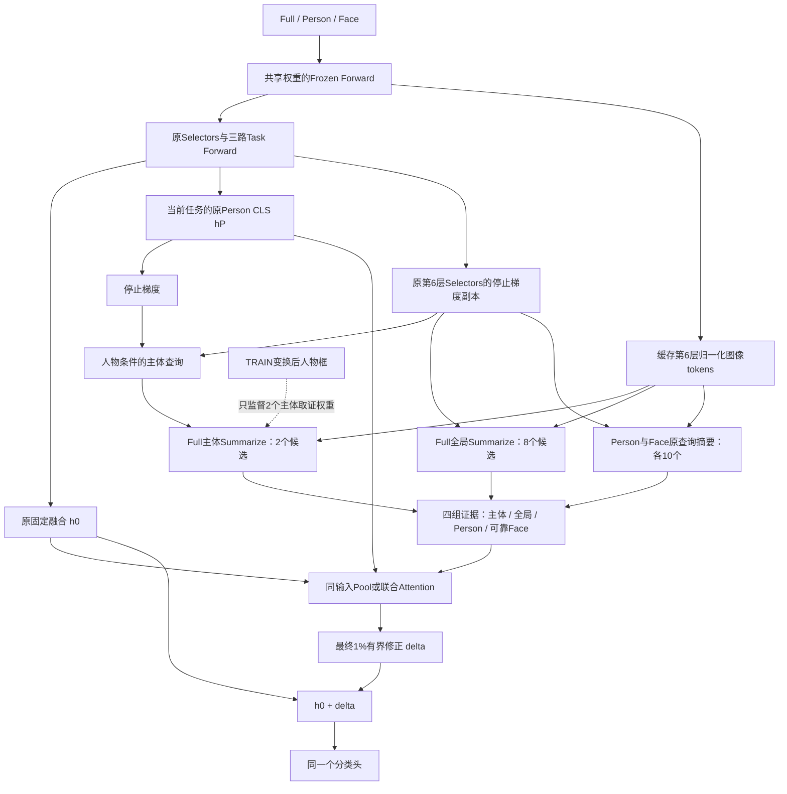

# 让Summarize先区分当前人物：下一阶段Attention实验方案

日期：2026-10-29。状态：仅研究方案，不修改模型/训练代码、不创建实现分支、不启动GPU作业、不提交或推送。本方案接续seed1历史强底座32.6800／39.5292及私有Summarize四组结果；不使用A/B教师或历史任务参数组装。

## 1. 建议研究什么

建议把问题定义为：**在保留MULTI-LANE原三视图学习的前提下，让新增Summarize明确区分当前人物与全局场景，再检验Attention是否比读取同一证据的Pool更有效。**

主候选包含三个相互配合的约束：

1. 原三路完整保留并隔离新增梯度，避免重新损伤Full。
2. 新增Full摘要分成少量主体候选与全局候选；当前Person内容在主体摘要读取Full tokens之前进入查询。
3. 只对主体候选的实际Summarize权重施加TRAIN人物框锚定监督，不约束全部场景摘要。

首轮用“三种取证方式×两种读出”的六组对照拆开上述机制；不同时搜索层数、query数量、scale、门控、专家或新排序损失。Attention能否提高精度是待检验假设，不是计划结论。

## 2. 这不是将旧失败方案换名字

本轮新查询Pool与Attention的Test分别32.6704／39.6075和32.6607／39.5576；FP32补评分别32.6704／39.6074和32.6606／39.5578。没有同时提高最终与阶段平均。新Attention的Face入口、Person入口条件贡献也为负，正确人物条件尚无稳定优势。

已有代码TaskSelectorConditioner还包含person／bbox_person／person_patches模式，早已尝试用人物内容产生Selector查询偏移。空间摘要也试过目标框相对位置偏置；受保护联合Attention试过把新增Full读取硬限制到人物区域。因此，“把Person喂给MLP改Query”或“再加bbox”本身都不应作为新机制报告。

本候选的主要不同是：**主体与场景候选共存，定位监督直接作用于少量主体Summarize的真实取证权重，且只改变受保护旁路。** 查询条件、锚定监督和Attention读出均有对应控制，不把新增参数、全局摘要消失或写入预算变化混成一种解释。

已确认的事实是原函数得到保护、查询有梯度、输出近1%上限，而新增修正未达到目标。尚未确认的假设是人物绑定不足、摘要到最终Task CLS语义空间的对齐不足，以及小任务训练量不足各占多大影响。该方案优先检验第一项，不能承诺解决另外两项。

## 3. 论文依据与迁移边界

[MULTI-LANE §3.3、式3](https://arxiv.org/html/2405.15633v1#S3.SS3)用任务Patch Selectors汇聚Frozen Forward的图像tokens，形成Summarized Patches，再由独立Task Forward经Prefix-Tuning学习任务表示。本项目保留这一原流程，研究输入为“原图＋指定人物”时，新增取证怎样依赖人物。

[DSCT：Two in One Go](https://arxiv.org/html/2404.17205v1#S3.SS2)将主体与上下文查询分开并通过空间、语义关系交互，同时使用定位与情绪监督。这里仅借鉴“主体／上下文分工及定位监督有独立职责”；不迁移其Deformable DETR、检测预测、Hungarian匹配或多尺度整网，也不引用其非增量EMOTIC成绩作为本项目可达到的增益。

[Conditional DETR](https://arxiv.org/html/2108.06152v3#S3)用条件查询改善cross-attention的定位。这里只借鉴“查询应带有明确对象条件”的原则；下面的低秩条件器、框内质量损失和六组消融是本项目方案，不是上述论文的原样方法。

## 4. 原模型保留什么

原三视图仍使用同一套冻结CLIP ViT权重分别编码。各任务保留原共享Image-token Adapter、Patch Selectors、Prefix Prompts及Full／Person／Face三条Task Forward；原MSA、Drop & Replace、FFN及分类头位置均不改。

原可靠Face特征融合h0=0.64hF+0.16hP+0.20hR，不可靠Face为0.8hF+0.2hP。原融合/辅助BCE和Adapter-ASL仍按32.6800配方更新原参数。所谓保护，是新增目标不改变这组原更新；不是从任务开始就冻结原模型，也不是从旧checkpoint安装一个B0教师。

任务结束后原任务参数和新增模块一起封存。推理运行全部已见任务，各任务用自己的类别行读出，再拼接类别logits；不取“最好的任务”、不用DDAS或跨任务可变专家。

## 5. 新数据流与“提前”的准确含义

先正常运行原三路Task Forward得到hP、h0，同时缓存第6层图像tokens；再在旁路中先用hP构造主体查询，后执行Summarize。**“提前”指在新增分支压缩Full证据之前引入Person条件，不是把最终hP送回尚未完成的原第6层。** 不存在循环，也不重跑原Task Forward。Full冻结流不接收人物条件，仍可按原方式共享。

这里hP来自同一个当前训练模型，且停止梯度；不来自外部教师。本文只改变交互分支，不让它生成的摘要替换原Task Forward输入。

## 6. 新Summarize如何定义

### 6.1 全局与主体共存，保持摘要总数

新增分支每个视图仍为10个摘要，联合memory总长度仍为30：

- Full全局候选8个：原第6层前8个Selectors的sg副本，读取全部197个图像tokens，含Frozen CLS；不接受定位监督。
- Full主体候选2个：原后2个Selectors的sg副本，加仅供主体候选使用的偏移与条件器，只读取196个patch，不读没有空间位置的Frozen CLS。
- Person、Face各10个：沿用原Selectors的sg副本，图像token来源和可靠性规则不变；第一版不再给它们增加上一轮的共享可学习U。

以上布局、CLS可访问范围和mask在六组中完全相同。因此，条件组与对照的差别不是多出摘要或突然删掉全局场景。Full主体与全局都不预先指定为“姿态”“交互”或“背景语义专家”；这些名称只规定监督及读取范围，不保证学出的语义。

2＋8是控制规模的首版设定，不是最佳比例结论，也不是借调query数量寻找提升。

### 6.2 当前Person内容如何改变主体查询

令p=sg(LN(hP))，维度512。只为2个主体候选生成低秩条件偏移：

`dS_t(p) = (A_t * tanh(C_t p)[None,:]) B_t`

其中A为2×16，C为16×512，B为16×768，共20512参数/任务，无bias。另有主体私有U_t，形状2×768、1536参数/任务。

`S_subject = NormMatch(sg(S_F,last2) + U_t + dS_t(p), sg(S_F,last2))`

NormMatch保持原查询模长，主要改变方向，避免把内容条件的作用混成softmax温度变化。C/A按独立私有随机流初始化，B和U为0；读出Output同样零初始化。初始化的融合输出精确等价于B0。第一个分类更新只让Output先动属于预期；定位组的U/条件输出矩阵可通过定位目标直接学习。

三种取证组用完全相同的条件器结构。任务常量组将p替换为任务私有、固定的非零随机参考向量（buffer，独立RNG），训练/推理均用同一个向量；它可学习静态查询调整，但不读取当前Person内容。该组后置读出仍看自己的Person CLS，因此准确地控制的是“是否在Summarize之前使用当前Person”，不是删除所有Person信息。

匹配的是名义参数、初始化和预算，不声称静态与动态函数有相同有效自由度。与已有无条件器结果的跨轮差异也不能唯一归因于当前人物条件。

### 6.3 仍然使用MULTI-LANE的加权汇聚

对sg的Full patch tokens gF：

`alpha_m = softmax(S_subject,m @ gF.T / sqrt(768))`

`G_subject,m = alpha_m @ gF`

条件只改变选择权重，Value仍来自Full图像tokens；不把Person向量直接拼入主体Value作为“找到了Full证据”。这仍不能完全排除通过选择分布编码Person的捷径，因此必须保留人物交换和情绪判别归因。

## 7. 定位监督怎样避免重复旧区域限制

只对Full的2个主体候选监督，不对全部10个Full摘要做框内硬mask。已知目标人物框跟随实际Full crop、flip、resize变换；使用真实几何与可见比例，不用原图坐标直接解释增强后patch。

令rho_i为第i个patch被当前人体框覆盖的面积比例，则：

`L_loc = mean_valid_person,subject_slot [ -log(sum_i alpha_mi * rho_i + eps) ]`

只对bbox合法、Full中人物至少90%可见、存在相交patch的人物启用，其他人物该项为0；部分可见仍可保留主体候选读取，完全不可见时屏蔽主体memory，8个全局候选和Person／Face继续可用。

该监督不要求注意力均匀覆盖整个人体，不要求框外所有情绪证据无效；不强迫8个全局候选留在人物框内。框仅用于TRAIN锚定监督及已有可见性元数据，推理没有新增硬ROI读取规则。

首版lambda_loc建议0.01，前5epoch线性升至0.01；这是待执行前锁定的工程起点，不是验证过的最优权重。首先看实际有效样本量及梯度是否有限，不进行Test搜索，也不因短期mAP变化中途调整。无有效人物的batch跳过定位项；记录有效样本数，不能把跳过当成有效学习。

L_loc只连接新主体U和低秩条件器；原Selectors/tokens均sg，故不会改变原Adapter、Selectors、Prompts、head，也不会直接训练Pool/Attention的Key、Value、Output。相对仅依靠“1%末端修正→分类头”的分类梯度，查询新增了明确的空间学习信号。

定位正确只说明读取位置受到约束，不说明那些patch带来互补情绪证据。ViT深层patch经过全局注意力，框内位置也不是纯净的人物内容；2个槽位也可能读同一片区域。首版记录这些现象，不自动加多样性loss。

## 8. Pool与Attention怎样公平比较

保持原共同的Query：LN([sg(h0);sg(hP)])经1024→64投影；条件信息、数据、可靠性、层数、最终cap一致。

Attention：四头、64维、单层、一个读出Query；读取Full全局8、Full主体2、Person10、Face10，外加零K/V的Null。主体无效和Face不可靠均在softmax之前屏蔽。四种摘要类型用同尺寸type embedding，不增加新的Attention层或Query数量。

Pool：同一Value投影后对四组分别取均值，将[共同Query64、四组均值各64、Face有效标记1、主体有效标记1]拼成322维，再用322→127→64 GELU，接共同64→512 Output。无效组均值置0。它读取的摘要、类型、有效标记、任务/Person条件与Attention一致，不回到“MLP只读最终CLS”的不公平比较。

按无bias Q/V/K/O与上述定义估计：Attention每任务221728参数，Pool221789，相差61；8任务约177.38万/177.43万新增参数。实现后重新统计，包括buffer与可训练参数分开报告。主体/全局的训练后摘要可因读出而不同，不宣称两种读出训练后接收逐值相同的摘要。

末端继续`h_final=h0+Bound_0.01(raw;h0)`，无新学习门控、无新分类头、无新残差额度。1%不是已证明最优，只为把本轮变量限定为人物取证。若将来研究剂量或语义读出，必须另立对照。

## 9. 六组完整消融

| 新增取证方式 | 同摘要Pool | 联合Attention | 要回答的问题 |
|---|---|---|---|
| 任务常量条件，无定位loss | 完整8task | 完整8task | 在统一新布局下，静态取证和读出参照 |
| 当前Person内容条件，无定位loss | 完整8task | 完整8task | 内容在压缩前进入，是否已经足够 |
| 当前Person内容条件＋主体定位loss | 完整8task | 完整8task | 明确锚定监督是否改善对应与融合 |

每列纵向比较分别定位人物条件、定位监督；同一行横向比较Attention是否比Pool更有效。六组布局、所有参数构造、共同投影初始化、原函数训练流完全匹配。定位loss只在最后一行启用，其他组可只读记录定位误差，不将其梯度用于优化。

保留已有B0和CLS-MLP，分别为32.6800／39.5292和32.7139／39.5923。B0通过每组OFF逐值重放和历史边界审计匹配，无需为了新旁路额外训练第七组B0。若无法精确匹配，先修随机流/数值实现，停止将差值作为结构效果解释。

## 10. 原目标与新增目标的梯度职责

| 目标 | 更新对象 | 不更新对象 |
|---|---|---|
| 原融合/辅助视图BCE | 原任务Selectors、Prompts、当前分类头等，沿原B0规则 | 新旁路 |
| 原Adapter-ASL | 原Image-token Adapter，沿历史路由 | 新旁路 |
| 新增融合BCE | 主体私有查询/条件器、摘要类型编码、Pool或Attention读出 | 原三路参数、原head、Frozen ViT |
| 主体定位loss（仅指定组） | 新主体U与条件器 | 原三路、head、Pool/Attention读出 |

概念上新增分类目标为`BCE(W_sg [sg(h0)+delta], y_current)`。实际继续使用当前类梯度和历史legacy_full_zero归一化，不偷偷改变成另一种类别平均或辅助监督。

独立optimizer/scaler/scheduler、初始化与采样随机流；原学习更新仍与历史强底座逐边界核对。模型在同一30轮内自行训练，没有额外5轮固定头阶段，也不推理换回其他checkpoint的分类头。

## 11. 正式配方与实现前条件

| 项目 | 建议固定值 |
|---|---|
| 数据/seed/任务 | EMOTIC，seed1，完整8任务[5,3,3,3,3,3,3,3] |
| 训练预算 | 每任务30epoch、B64；每组13950主更新；六组合计83700主更新 |
| 优化 | Adam、WD0、任务内cosine；主LR0.0125，Adapter/新查询/读出LR0.0004 |
| 原强底座 | b32、index1、scale0.03、Person颜色扰动关闭，原辅助BCE0.1与Adapter-ASL |
| 原任务参数 | 10共享Selectors、原Prefix Prompts和三路Task Forward |
| 新旁路 | index5、第6层；Full8全局＋2主体，Person/Face各10；低秩16，Attention64维/4头/单层/一个读出Query |
| 定位监督 | 仅指定组；lambda0.01，5epoch线性warmup，>=90%可见，真实变换框 |
| 最终写入 | 四类摘要共同读出，固定最终1%RMS上界；无学习门控 |
| 数值 | 原72线程、AMP/TF32与报告RNG；新增Summarize及读出显式FP32、历史head AMP不变；历史CPU每batch float32 sigmoid |
| 评估 | 历史samples_intersect_seen_classes；8task Validation/Test、最终与阶段平均；所有组固定30epoch终点 |
| 保存 | 每epoch完整恢复状态、每任务compact、双方optimizer/scaler/RNG、manifest与源码SHA、原函数及旧任务审计 |
| 未来硬件 | 只GPU0，B64保持，按实测显存自动排队；原则上最多4训练/2评估，不用改batch破坏历史随机流 |
| 未来输出/日志 | ./output/person_grounded_summary/<run>/<arm>/，./logs/person_grounded_summary/<run>/ |

输入延续已核验EMOTIC路径、CLIP权重、Face manifest及SHA，不增加第三方检测器/姿态网络。执行前创建codex/实验分支并通过Git-only部署独立worktree；保留旧main/test-only和未提交分析。本次没有创建分支或运行命令。

实现前必须核对定位监督供给：现有各任务训练人数为5353／4394／861／9931／4352／2536／627／1526；每epoch主更新84／69／14／156／68／40／10／24。task6只有627人、300次总主更新。需要用TRAIN统计各任务实际>=90%可见率、可定位patch数、多人/重叠框比例及有效定位更新数。若task6几乎无有效定位数据，应先报告该假设无法检验，不自动改Full裁剪、增加epoch、过采样或偷用其他任务标签补数据。

## 12. 实现检查与评估归因

先修复并验证新Summarize的autocast边界，必须在CUDA AMP环境中实际检查dtype；`.float()`不是充分保证。只做少量更新的smoke查正确性，不根据task0—2精度晋级，六组正式效果都覆盖task6/7。

必要实现检查：

- 初始delta=0、整个旁路OFF逐值恢复B0；原Adapter/Selectors/Prompts/head的主更新、loss、RNG与历史一致。
- 新分类目标不向原参数/head传梯度；定位目标只向主体U/条件器传梯度；输出层零初始化后的后续步查询确实可学。
- 真实crop/flip/resize的bbox-patch对应、CLS排除、部分可见、全不可见、坏框安全回退。
- 不可靠Face内容任意替换不改变输出；主体不可见仅去掉主体memory，不删除Full全局场景。
- 最终1%cap、optimizer无重复参数、旧任务完整冻结、恢复后结果一致。

各组所有8阶段Val/Test保存ON/OFF、原三路、四类摘要范数、修正RMS/饱和、逐类AP/BCE/F1和可靠性/人数分层。原三路及OFF必须不变；ON的无可靠Face人群可因Full/Person修正变化，但不能受无效Face内容影响。

task0/2/6/7的真实前向归因至少包括：

| 干预 | 保持不变 | 要检验什么 |
|---|---|---|
| 关闭整个delta | 原三路/head | 净贡献及原函数保护 |
| 将早期Person条件偏移置0 | U、读出、h0、晚期Person Query | 当前条件是否有直接作用 |
| 只交换早期Person条件 | 接收者Full tokens/框可见性、Person/Face memory、h0、晚期Query/head | 人物内容是否改变Full压缩前取证 |
| 只移除主体memory | 全局/Person/Face、h0和读出Query | 定位出来的主体证据是否有条件贡献 |
| 只移除Full全局memory | 主体/Person/Face、h0和读出Query | 新分支是否还需要场景补充 |
| 分别移除新增Person/Face memory | 早期条件、h0、晚期Query/head | 各辅助入口是否提供补充 |
| 交换后匹配原delta范数 | 接收者原函数和原修正额度 | 方向选择收益是否独立于幅度 |

供体在同图、双方可见的人物中按固定ID规则选择，不按预测或标签挑donor；完整报告既有>0可见人群及预先锁定的>=90%可见子群，说明人数差异，不能跨人群直接读mAP差。paired native使用完全相同batch边界。

另对已选人物对按当前可评价类别是否有标签差异分层。相同情绪的人物换条件不必降低情绪预测；不能把它当必然失败。对标签不同的类别，检查`(2*y_p-1)*(z_own-z_swap)`的平均方向及配对AP；这是诊断指标，不是新训练排序loss，也不使用未来任务标签选人。

报告框内注意力质量、正确框/他人框的差异、同图不同人物summary差异，但这些不代替mAP与条件贡献。空间绑定可能提高而情绪分类不提高，应允许并明确记录这种否定结果。 若只有主体证据有贡献，而新全局/Face入口没有价值，应将收益定位为人物条件取证，不能自动称作三视图关系融合。后续若要作该论文机制主张，再补相同预算的memory来源训练控制；只读入口关闭不能撤销训练共适配。

## 13. 晋级/停止规则

三个层次分别判断，不强行合并为“Attention成功”：

1. **绑定成立**：动态条件确实改变主体取证，并在预定义可见/标签差异人物对上显示正确人物优于错配人物的重复趋势；原图聚类区间和样本量支持。热图好看或L_loc下降不足以满足。
2. **补充有效**：同checkpoint移除主体证据会降低最终及阶段平均，主方法两项Test同时超过B0和已有CLS-MLP。若只有绑定成立，说明定位并非足够瓶颈，不继续堆定位强度。
3. **Attention有额外价值**：在同一取证/定位监督行内，Attention同时胜过Pool的两项Test；主要差值在固定模型配对区间中有支持，后续才讨论多seed。若只有Pool改善，围绕补充取证报告，不把收益归给Attention。

重点检查task6三类及其对最终差值的贡献，同时报告全部26类，不通过删除弱类/弱人群制造结论。微小正差且区间跨0只算候选，不称稳定优势。Test已经参与长期开发，保留完整历史，不把此后Test重新描述为从未观察的独立测试集；当前方案固定终点，不用Test挑lambda、epoch或组合。

若六组都无法提高两项Test，停止当前受保护后置1%读出接口。若空间绑定成立而mAP仍无益，下一问题是摘要证据到最终Task CLS/分类头的语义读出，而不是再增加查询、层数或位置强度；该方向需另做方案，不在本轮自动启动。

## 14. 可向导师使用的叙述

> MULTI-LANE的Patch Selectors解决的是任务相关取证。我们研究人物级多标签识别中，怎样进一步让取证对应当前人物。为保护已有三视图能力，原Task Forward继续按原配方学习；在独立交互支路保留全局摘要，同时让少量主体摘要由当前Person内容提出查询，并用已有训练框约束其实际读取位置。随后比较同一证据经池化或Attention组合，检验定位、互补证据与动态融合是否分别带来收益。

这段描述的是研究设计；实验完成前不加入“有效提高”“成功解耦”或“优于原模型”的结论。
