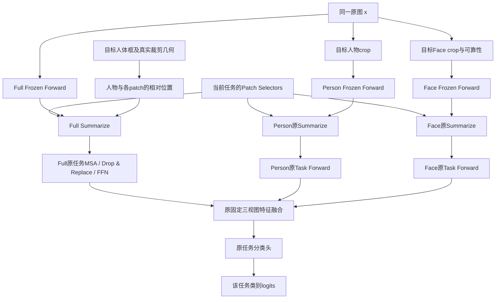

# 下一阶段方案：让MULTI-LANE的Patch Summarization同时依赖任务与目标人物

日期：2026-10-22。状态：研究方案，未实现、未启动实验。

本轮只阅读论文、代码和已有validation预测，新增本文与只读统计JSON，更新三个上下文文档。没有修改业务代码、配置或训练脚本，没有新的模型前向、GPU作业、test评估、Git提交/推送或实现分支。此前未提交分析文档及其他工作树保持原样。

## 1. 推荐的主线与它要回答的问题

建议把下一阶段的主问题定义为：**MULTI-LANE已经能为不同增量任务提取不同证据，如何让同一任务在同一张多人图片中，为指定人物提取不同的场景证据？**

首个候选是“目标人物锚定的Patch Summarization”：原任务Patch Selectors继续负责选择任务语义，再在它们读取Full冻结图像tokens时加入人物框相对位置条件。位置条件直接作用于每一个图像token的汇聚分数。保留原三路Task Forward、Person/Face内容路径、固定末端特征融合和分类头。

这一步属于**三视图融合之前的证据提取改进**，还不是新的三路交互网络，也不是已经证明有效或足够独立发表的创新点。它的价值在于提出一个与旧实验不同、能够通过正确框/无目标位置/交换框检验的机制假设。

后续若该机制成立，再单独研究“同图、不同人物、当前任务标签不同”的绑定监督。第一轮不把新空间模块、新损失、姿态网络、对象检测、MoE和动态融合一起加入。

## 2. 新核对的结构性证据

仅读取已有aux0匹配基线的task7完整validation分支预测，按原图分组：

| 项目 | 数量或结果 |
| --- | --- |
| 完整人群/原图 | 2397人/1705图 |
| 同图多人的图片/人物 | 527图/1219人 |
| 至少两人26类标签集合不同的图片/人物 | 519图/1203人 |
| 同图人物Full logits最大绝对差 | 0，逐值相同 |
| 同图人物Person logits平均绝对差 | 2.4388 |
| 同图人物融合logits平均绝对差 | 0.7295 |

差值统计将每张图其余人物与该图第一人比较，共692次比较，不把它称作所有两两组合。

这说明基线确实依靠Person/Face补充人物差异，而Full在同图各人之间提供共用场景判断。它不是标签泄漏或代码错误：没有人物条件时，确定性的Full分支对相同Full像素自然给出相同输出。

这也不意味着Full无用，或所有同图人物必须有不同预测；共用上下文往往有价值。可以确认的限制是：**Full本身无法针对同图不同人物选择不同证据**。519张标签有差异的图片说明这个限制在实际人群中存在，但不能据人数直接估算可提升的mAP上限。

该证据尚未证明位置约束一定能提分。上一轮Query交换也没有证明目标绑定不足是唯一根因；这里将它确立为下一项待证伪假设。

统计与来源SHA保存在`output/target_anchored_summarization/planning_20261022/saved_validation_person_binding_audit.json`。没有读取新的test结果。

## 3. 用原论文术语理解需要改变的位置

MULTI-LANE原论文研究图像级多标签增量学习。Frozen Forward提供各层的图像表示；每个任务的Patch Selectors将图像tokens汇聚成少量Summarized Patches，送入Prefix-Tuned MSA与Task Forward。每层重新汇聚，Drop & Replace保留任务CLS和Selectors。推理运行所有任务路径并拼接对应类别logits。[MULTI-LANE §3.3](https://arxiv.org/html/2405.15633v1#S3.SS3)

在EMOTIC的人物级设置里，输入实际上是“图片x+目标人物p”。任务编号t回答“识别哪些情绪类别”，人物编号p回答“为图中谁判断情绪”，二者不能互相替代。

原Full汇总是`Summarize(Full tokens(x), Selectors(t))`；本候选是`Summarize(Full tokens(x), Selectors(t), box(p))`。Frozen Forward仍与p无关，可以在所有任务间共享。人物条件只存在于任务侧读取图像表示的接口。

准确接入位置是：**Full Task Forward的Summarize内部，在Selector–image相似度进入softmax之前**。它位于Frozen Forward与任务路径之间的读取接口，不是将可训练Adapter插入冻结骨干，也不是在Summarize以后向Person写入新的特征向量。

## 4. 论文中值得借鉴的机制与迁移边界

| 来源 | 借鉴内容 | 本项目如何使用/不直接迁移的部分 |
| --- | --- | --- |
| [MULTI-LANE](https://arxiv.org/html/2405.15633v1#S3.SS3) | 任务相关的Patch Summarization与独立Task Forward | 在原汇聚公式中增加人物条件；保留原MSA、Prefix-Tuning、Drop & Replace和推理协议 |
| [DSCT，ACM MM2024](https://arxiv.org/html/2404.17205v1#S3.SS2) | 区分主体和上下文，并结合空间与语义关系 | 借鉴“主体位置不能只由全局语义替代”的原则；不迁移其整套Deformable DETR、检测、匹配和联合定位训练 |
| [Spatially Conditioned Graphs，ICCV2021](https://arxiv.org/html/2012.06060v3#S3) | 根据接收人物与来源实例的相对空间关系组织信息 | 只将“空间条件应显式参与关系”迁移到人物框–图像patch；不宣称复现对象图或获得了真实HOI关系 |

DSCT的主体查询与上下文查询通过空间和语义关系聚合；其原始任务含定位监督。本项目已有给定人物框，使用的是框条件分类，不改成检测器。SCG原方法使用检测实例图，我们这里使用规则patch位置，表达能力和监督条件都不同。

以下公式和实验设计是本项目新假设，不能写成上述论文原样提出的方法或已验证收益。近邻不等于相关人物/物体，空间关系也不等于情绪因果关系。

## 5. 新的数据流

图示为每层/每任务的读取关系，三条Task Forward仍各有自己的任务CLS状态。三视图使用同一套冻结CLIP权重，并非三个可训练backbone。每任务三视图继续共享原Selector/Prompt/head参数。

每层Full过程：

1. Frozen Forward输出原图像tokens，不接收人物框、不被新模块改写。
2. 原任务Selectors与图像tokens计算任务语义分数。
3. 根据每个patch相对当前人物框的位置，增加一个小的空间分数。
4. softmax得到汇聚权重，仍对原Full tokens加权，得到原数量的10个摘要。
5. `[Full task CLS; 10个摘要]`进入原Prefix-Tuned MSA，再执行原Drop & Replace及FFN。

Person与Face沿原流程提取信息，末端仍融合三个归一化任务特征并送入原分类头。新Full输出可随目标框变化，成为“指定人物条件下的场景表示”。它不是纯背景，也不是完整人物关系图。

推理时，给定同一人物p，所有已见任务t都读取该人的位置条件，分别输出本任务类别；最后拼接全部已见类别。不选择一个最佳任务，不运行DDAS。

## 6. 首版模块的具体形式

用当前任务t、第l层、第m个Selector表示原相似度：

`e[t,l,m,i] = <s_hat[t,l,m], z_hat_F[l,i]> / sqrt(D)`。

增加人物条件后：

`B[t,m,i,p] = visibility(p) * tanh(<w[t,m], phi(patch_i, box_p)>)`

`A[t,l,m,:,p] = softmax(e[t,l,m,:] + B[t,m,:,p])`

`G_F[t,l,m,p] = sum_i A[t,l,m,i,p] * z_hat_F[l,i]`。

帽号表示沿用现有block的归一化，不额外引入可学习Norm。softmax仍覆盖原197个输入tokens（196个patch+Frozen CLS）。

### 6.1 空间特征与参数量

首版`phi`为6维：相对人体中心的dx、dy，|dx|、|dy|，patch被人体框覆盖的面积比例，以及常数1。dx/dy按人体框宽高归一化，分母至少一个patch宽度，再裁剪至[-2,2]并除2。覆盖比例使用patch面积作分母。

位置来自**实际送入Full的裁剪、resize和flip后坐标**。若需要完整人体中心/尺度，必须保留未截断的变换框；现有`bbox`只有截断坐标与可见面积比例，不能直接把截断框当完整人体框。该元数据改进不得改变Full像素或旧随机数轨迹。

Frozen CLS没有局部空间位置，设其空间特征为0，保留原语义读取。记录CLS注意力质量，防止模块只学成“普遍抑制/放大CLS”而没有利用目标位置。

每个任务每个Selector一个6维向量，10×6=60个参数；**同一任务的空间参数在12层共享**，8任务共480个新增参数。没有新增Q/K/V投影、特征输出MLP、Router或Expert。

空间向量全零初始化，开始时B=0，退化为对应B0。零点对w的梯度一般非零，避免将两个零初始化因子相乘造成分支无法学习。

### 6.2 为什么不只放第6层

MULTI-LANE每层都重新Summarize，并在Drop & Replace后恢复Selectors。人物位置是每次读取的条件，因此首版每层均用相同空间规则；不是堆12个新的Attention block，也不增加Task MSA长度。这里改变的是原有12次汇聚的读取规则。

这不是“多层一定优于单层”的结论。若首版通过，再把“仅第6层”作为使用范围消融；不一开始搜索Early/Middle/Late所有组合。需要记录各层偏置/CLS质量及实际贡献，避免把更多层数本身当成功解释。

### 6.3 对旧问题有什么约束，又没有约束什么

偏置范围为[-visibility,+visibility]；输出仍为原图像tokens的凸组合，没有无界的可学习Value/输出投影残差。这比自由生成向量再相加更容易限制和解释。

它**不能保证**输出语义不变、mAP不降或人物关系正确；后续MSA、归一化和共同训练仍可能放大影响。它也不强制所有注意力留在人物框内，远处场景线索仍可被任务语义选中。

无效框或完全不可见时visibility=0，精确回退原Full汇聚；部分可见按可见比例连续减弱偏置。Person本身仍有效，不因此屏蔽Person或其监督。数值异常必须回退，不用NaN框参与softmax。

## 7. 与以前失败方案的实质区别

| 以前的方案 | 以前改变的量 | 本候选改变的量 |
| --- | --- | --- |
| bbox/Person输入MLP，给Selector加query delta | 根据人物信息产生新的语义查询向量 | 对每一个“人物框–patch位置”显式计算标量空间分数；原语义Selector保留 |
| Person patch条件Selector | 从另一视图读内容后改变Full查询 | 不把Person外观改写成查询；直接使用已知跨裁剪几何锚点 |
| 人物摘要Query读Full摘要，再写回Person | 压缩后的摘要交互和Person Value残差 | Full压缩之前改变原patch的汇聚权重，不向Person添加生成特征 |
| target-aware裁剪 | 改Full输入内容、构图和取景分布 | 保留legacy Full像素和增强，只增加几何元数据/汇聚条件 |
| 视图独立Selectors或更多Selectors | 拆参数或增加语义容量 | 原三视图共享Selectors仍为10个；只新增极小空间参数 |

旧bbox查询模式在理论上也可能间接利用位置编码，不能说它完全没有空间信息。这里的不同在于**把人物与每个patch的相对位置显式放入选择规则**，而不是指望MLP从全局框向量自行学出定位。它仍然需要实验验证，旧失败使成功预期保持谨慎。

## 8. 第一阶段：先验证空间锚点是否带来净收益

### 8.1 三组必要控制

| 组别 | Full汇聚规则 | 新增空间参数 | 要回答的问题 |
| --- | --- | --- | --- |
| P0 原三视图控制 | 原Summarize | 0 | 相同监督和预算下的参照 |
| P1 无目标位置控制 | 同一空间模块，位置特征均使用固定整图参考框[0,0,1,1]，保留与P2完全相同的真实visibility门控 | 60/任务 | 可学习空间偏好、可见性门控和增加参数本身是否足够 |
| P2 目标人物空间条件 | 使用当前目标的真实变换框与可见性 | 60/任务 | 正确目标锚点是否提供额外信息 |

P1/P2参数量、初始化和计算形式相同；P1不含当前人物位置，但保留相同可见性信息和图片相关语义汇聚。这样P2超过P1时，不把可见性门控的作用误算为目标位置收益。两者有效函数空间未必完全相同，不应声称严格统计容量相等。

初始三组预测应等价，P1/P2的新参数初始值完全相同。P0必须在当前先导数据划分/监督下重新训练，不能直接用历史fullTRAIN模型替代匹配控制。

等价核验指训练开始的共同初始化，以及各组自身空间关闭/零参数对照。后续任务沿用各自合法历史状态，不跨组复制已训练参数来制造相同起点；每个新任务的空间参数独立置零，并记录原任务参数初始化协议。

### 8.2 固定训练计划

| 配置 | 提议值 |
| --- | --- |
| 数据/seed/任务 | EMOTIC，seed0，先task0–2 |
| 训练与holdout | 沿用既有、按原图固定的TRAIN 90/10 manifest；每个任务只使用当前任务合法fit样本/标签 |
| 训练预算 | 每任务30epoch，B64；若沿用既有manifest，fit数4854/3972/782，步数76/63/13每epoch，共4560更新；执行前按manifest核验 |
| 优化 | Adam每任务重置，WD0，cosine到0；原参数LR0.0125，新空间参数LR0.0004 |
| 主监督 | 所有组相同的融合BCE + 0.1×原三视图可用辅助BCE；这是恢复原B0监督，不是对aux0结果直接比较 |
| 新监督 | 第一阶段不加人物绑定、对齐、重建或蒸馏损失 |
| 其他模块 | MoE、ParaX、image-token adapter、旧selector-conditioner、cross-view residual、联合摘要融合全部关闭 |
| 输入/模型 | 原CLIP ViT-B/16；Full legacy，Person margin0.15/letterbox；Face原strict可靠性；10 Selectors，原Prompt长度与初始化不变 |
| 末端融合/head | 原特征融合，可靠Face[.64,.16,.20]、不可靠[.8,.2,0]；分类头不动 |
| 评估 | 相同TRAIN holdout及完整validation2397人，B64、workers0、AMP/TF32；第一阶段不访问test |
| 状态保存 | 每任务结束先保存完整可恢复状态，再评估；记录RNG、optimizer/scheduler、manifest、源码及输入SHA |
| 输出/日志（未来执行时） | `output/target_anchored_summarization/<run>/<arm>/`；`logs/target_anchored_summarization/<run>/` |
| GPU/启动 | 当前未分配GPU、未创建运行ID、未启动作业；实现阶段先核对空闲资源，再声明最终完整配置 |

恢复aux0→aux0.1可能改变结果，但三组监督完全匹配；不能据此声称辅助损失已被证明能够修复旧Attention。历史B0只作正式性能参照，不把不同训练人群/监督的差值当空间模块收益。

### 8.3 必做的模型内对照

在P2同一checkpoint上：

- 正常使用本人框；关闭空间偏置，保留共同训练后的其余参数；只换同图另一人的空间框，保留本人的visibility门控、Person/Face输入与标签。交换不同时改变门控幅度，便于定位空间位置的作用。
- 正常与关闭的Person/Face端点应不变，Full及融合允许改变。关闭不是重新训练P0。
- 交换采用先前锁定的90%可见、中心可见、不同身体框、ID循环规则，不用预测或情绪选择donor。主要看可交换者，不用完整人群稀释效果。
- 正确框必须表现出相对交换框的正向判别趋势；仅有预测变化或注意力位置变化不算成功。重叠框、同情绪人物可能差别很小，另报告几何和标签差异分层，不强迫每个样本下降。
- 逐任务报告融合/Full/Person/Face、可靠Face、多人/单人、可见性分层，以及完整val与每任务holdout。不同人群mAP不混合平均。
- 分开报告Full本身增强与三视图互补：比较同checkpoint的融合−Full单路差值以及空间开关差值。若融合提高主要伴随Full单路提高，应称作目标相关证据提取收益，不直接称作三视图交互成功。

记录空间参数变化、偏置幅度/饱和比例、注意力变化、Frozen CLS质量、目标框内/周边/远处质量分布。不能用“注意力都落框内”作为成功条件：情绪上下文也可能在框外，深层patch本身还含全局混合信息。

### 8.4 晋级与停止规则

提议执行前锁定以下先导筛选门槛，不使用历史test改门槛：

1. P2相对P0的task2完整validation最终mAP和三阶段平均都至少+0.20个百分点；至少2/3阶段方向为正。
2. P2相对P1的最终和阶段平均至少+0.10，排除仅增加参数/普遍空间偏好的解释。
3. TRAIN holdout方向支持，至少task0/1无一致负向；task2 holdout较小，单独报告，不让其局部波动决定晋级。
4. 同checkpoint关闭空间偏置的validation融合表现应下降：task2至少0.10个百分点、三阶段平均为正；正确框相对交换框的可交换者mAP方向为正，并报告原图配对bootstrap。
5. Person/Face端点相对匹配P0的最终及平均下降均不超过0.20个百分点，避免靠重写共享参数牺牲其他视图。若净融合明显更好但此条未过，标为机制不符，不自动按原假设晋级。

这些数值是保守的计划筛选规则，并非统计显著性阈值。bootstrap区间跨0时只能叫正向候选，不能叫稳定提升；小子集的框交换需要足够原图数。若测试功效不足先报告不确定性，不修改筛选人群追求有利结果。

若P2未超过P0/P1，或关闭无损、交换无正确目标优势，停止当前空间汇聚候选，不立即扩8任务或加绑定损失“救结果”。若仅P1/P2同涨，应按一般空间归纳偏好解释，不能声称人物关联成功。

如果首版通过、拟进一步宣称利用了人物周边上下文，再补“Full只汇聚目标框内位置tokens”的同预算范围控制，区分重读人物与增加场景补充信息。该控制也必须屏蔽Frozen CLS的位置捷径；深层patch已混有全局信息，因此它只是汇聚位置范围控制，不是纯人物RGB裁剪或严格背景因果干预。第一阶段不自动增加这一训练组。

## 9. 第二阶段候选：用同图人物差异约束位置绑定

只有第一阶段显示正确人物锚点有净收益、当前任务TRAIN fit内配对量足够时，才考虑此项。它是独立后续实验，不在第一阶段默认启用。

仅空间输入仍可能被忽略，或被用于普遍场景偏置；可以进一步要求“换到另一个确有不同标签的人物框时，对应类别预测应跟着目标变化”。

对同一张Full增强图x、两名合法训练人物p/q，仅使用当前任务类别集合C_t。定义D为当前类中y_p,c与y_q,c不同的类别：

`d_c = (y_p,c - y_q,c) * (logit_F(x,b_p,c) - logit_F(x,b_q,c))`

`L_bind = mean_{c in D} softplus(-d_c)`，空集时为0。

如果p在某类为正、q为负，就要求该类Full预测在p框下更高；双方标签相同的类别不被当作负对。**不将同图所有人都做互斥InfoNCE负样本**，因为情绪是多标签且可共享。

必须使用Full单路径在同一像素输入下的两个框条件结果。辅助配对中两框使用相同visibility门控（两者可见比例的较小值），避免仅靠门控幅度区分人物。若对本来就包含不同Person crop的融合结果做该损失，模型可能仅靠Person差异满足约束，无法证明Full定位成功。框不能直接作为classifier输入；通过汇聚权重影响原图像Value。

第一版可预设绑定系数0.1，不搜索margin/温度；系数与损失归一化须在执行前锁定。源BCE的legacy归一化、当前类mask与新loss强度需要显式记录，不能用隐藏旧类0标签构造配对约束。

### 监督和成本控制

- 所有对比使用同一合法fit人群、相同配对/增强/前向预算。先统计每任务配对原图数、当前类别差异数；只含旧类或未来类差异的pair不能用于本任务绑定。
- 同图两个框必须对应**同一份Full像素增强**；否则损失可利用随机裁剪差异。所需额外几何元数据/配对随机数与主采样隔离。
- 配对监督只使用本任务已经合法提供的样本和标签；不从holdout/val/test找配对，不调用旧任务样本，不假装离线读取全部26类标签符合增量协议。
- 如使用额外配对前向，所有控制提供相同样本的普通当前类Full BCE，比较“普通配对监督”与“相同监督+绑定项”，并包含无目标位置的监督匹配控制。主BCE训练更新数与额外计算量都报告。
- 对完全不看框的Full模型，在相同像素下两个logits相同，绑定差值恒0；这项loss不能凭空创造人物信息。其用处是约束已有框条件通路，不是单独替代模块。

如果配对数不足或高度集中在少数类，不增加该loss、不使用未来标签补足。若绑定项只改变热图/框敏感性而无融合收益，仍应停止，不将成功标准改成“模型终于会区分人物”。

## 10. 增量学习、计算量与实现风险

每任务完整封存空间w、原Selectors、Prompts和对应classifier参数/掩码；旧任务依赖的Norm、scale、几何规则也固定。不能只冻结新w就承诺零遗忘。没有跨任务可学习共享空间网络或变动统计。

Full Frozen Forward不受人物/任务条件影响，仍在任务间共享图像流，避免此前Frozen Forward MoE按任务重算图像流的问题。Person/Face仍有原计算；不能宣称整网提速3倍。480个参数说明存储开销小，不能替代真实显存、吞吐和延迟测量。

需要核验的风险：

1. **信息可能本来就不足。** 14×14位置分辨率粗，深层patch已含全局信息；框锚点不提供手势、视线或真实物体关系。若失败，不能靠加大位置偏置自动补齐这些证据。
2. **目标可能不在Full裁剪里。** 保留legacy且完全不可见回退；先统计各任务fit/holdout的可见率和小目标patch覆盖。若几乎无有效目标，先报告不可验证性，不依据val更改裁剪规则。
3. **共享参数仍会共同学习。** Person/Face结构没改，不等于从头训练后端点必定相同；只有同checkpoint运行时关闭/交换空间项能检验局部影响。
4. **空间偏置可能被忽略或走CLS捷径。** 需要目标框控制与真实mAP贡献，不靠参数非零或热图判定。
5. **空间先验可能过度局部化。** 保留所有区域的语义读取和全局CLS，记录远处上下文；不把人物框当情绪证据的硬边界。
6. **位置可能成为数据偏置。** 例如画面中心/人物大小与类别相关；无人物空间控制、同图交换和独立seed都需要保留，但仍不构成因果识别证明。
7. **评估集已被反复观察。** 既有validation、holdout和历史test均有过多轮分析；本轮最后报告test不意味着它是全新的未见评估集。锁定方案后不反复搜阈值，报告探索性质；训练seed复验描述训练波动，仍不能替代真正未参与设计的独立数据验证。

未来实现前需先解决坐标元数据、零初始化/RNG等价、非法框回退、shared-view开关与旧路径保护、保存恢复等检查。计划中的相关文件会是`paired_transforms.py`、`model.py`、独立空间参数模块、runner/config与机制测试；本轮均未修改。

## 11. 后续实验顺序

1. 完成本方案讨论与TRAIN fit元数据预检，锁定输入、监督和预算；不调用test。
2. 实现后做默认关闭等价、零空间参数等价、真实Full像素及RNG不变、框变换、框交换只改Full、旧任务冻结及checkpoint恢复的smoke。
3. 先跑P0/P1/P2的seed0 task0–2，分析holdout/validation及模型内对照，按预先锁定规则决定继续或停止。
4. 通过后先复验先导训练seed1/2，检查收益是否重复；优先固定类别顺序与原图划分，仅改变训练初始化/采样随机性。若现有seed选项同时改变类别顺序，应分开控制或如实报告，不能全部称作同一类别序列的训练波动。如研究绑定监督，另做上述监督匹配控制，不把它与空间输入的收益混在一起。
5. 只有先导机制和重复性得到支持，再锁定一个完整8任务配置，报告最终/阶段平均，并与相同预算P0比较；最后一次性报告test。

本次用户只要求计划，不构成任何上述步骤的启动记录。没有安排8任务validation/test自动队列。

教师汇报可用表述：**原MULTI-LANE的Patch Selectors根据增量任务决定汇总哪些图像信息。EMOTIC还要求区分同一场景中的目标人物，因此我们拟在Full的Patch Summarization中加入人物与patch的相对位置，使摘要同时依赖任务语义与目标位置。三路Task Forward仍独立保留，Person与Face负责各自证据，最终按原方式融合。通过无人物位置控制、关闭空间项和同图交换框，验证收益是否确实来自目标人物相关的场景选择；该假设目前尚未实现和验证。**
