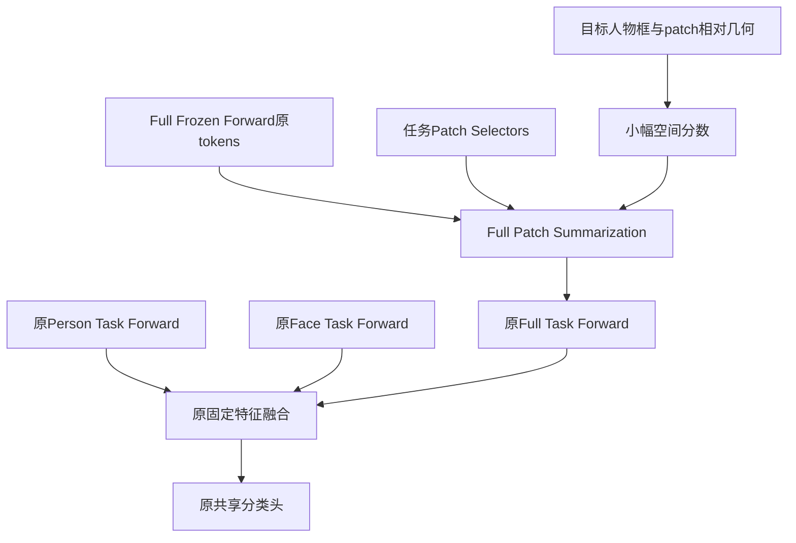

# 目标人物条件Patch Summarization：完整8任务结果与机制分析

日期：2026-10-22。正式批次`formal_gpu0_resume_seed0_20261022_01`；执行HEAD `1e28bfbb6be898df79d933352a4c5a13e6cfccc1`。本文取代此前“前三任务阶段分析”和“运行中”状态。

**结论：本轮训练获得了小幅且跨阶段一致的匹配基线收益；“推理时通过正确人物位置选择证据”的机制尚未得到支持。** 目标位置组相对匹配基线最终validation +0.8367、test +0.4601个百分点，八阶段平均分别+0.5525/+0.3241；但同checkpoint关闭位置项，最终validation仍为42.9723，几乎完整保留42.9717的正常表现。应将性能候选与人物绑定机制分开汇报。

本轮没有新训练或额外GPU前向，仅同步已完成产物、读取CPU权重、复算保存预测及原图配对bootstrap。三组完整训练、六路val/test、位置归因及总batch均exit0，恢复与预算审计通过。

## 1. 本轮到底改了什么

原MULTI-LANE利用Patch Selectors将Frozen Forward的图像tokens汇聚成Summarized Patches，再由Prefix-Tuned MSA、Drop & Replace及FFN得到任务CLS；各任务路径独立，并在推理时拼接任务类别输出。[MULTI-LANE §3.3](https://arxiv.org/html/2405.15633v1#S3.SS3)

本轮保持三条Task Forward、共享Selector/Prompt/head、末端固定特征融合，只改变Full的Summarize读取分数。在原语义相似度softmax之前加入`visibility × tanh(w·phi)`，phi含人体与patch相对dx/dy、绝对距离、覆盖率和常数。每任务60个参数，12层共享，全8任务480个；零初始化，旧任务整体封存。Frozen Forward的tokens不被改写。

这首先是Full的人物条件证据提取，而非新增三视图内容交互网络。整图位置控制采用固定整图参考框，但保留同一真实可见性门控、同样参数量/初始化/学习率，用于排除一般空间偏好和新增参数的解释。

## 2. 训练前提与完成状态

EMOTIC、seed0、类别任务5/3/3/3/3/3/3/3；每任务30epoch、B64，TRAIN原图固定90/10 fit/holdout，各组240epoch/12660成功更新/0跳步。Adam每任务重置、WD0，原参数LR0.0125/空间LR0.0004、余弦退火；AMP1024/growth1e9、TF32，workers/eval-workers0。融合BCE+0.1倍可用视图辅助BCE；无绑定、蒸馏、MoE、ParaX、image-token Adapter、旧跨视图残差或联合摘要模块。

CLIP ViT-B/16；Full legacy裁剪，Person margin0.15/letterbox；Face原manifest可靠性。原末端特征权重：可靠Face[0.64,0.16,0.20]，不可靠[0.80,0.20,0]。

task0–3在原GPU完成，120epoch/8760更新全部继承；迁至GPU0只重做task3报告，再训练task4–7的3900更新。没有重复训练已完成任务。两轮真实恢复短跑证明权重/后续随机数/采样/优化器等逐值一致，正式源边界与恢复模型逐值相同。完整训练后，三组val/test六进程及位置归因全部在GPU0结束。

## 3. 完整最终与阶段平均结果

| 方法 | Validation最终mAP | Validation八阶段平均 | Test最终mAP | Test八阶段平均 |
| --- | --- | --- | --- | --- |
| 原三视图方法（本轮匹配控制） | 42.1351 | 48.3591 | 31.8525 | 35.3942 |
| 加入整图位置偏好 | 42.5486 | 48.5989 | 32.1509 | 35.9578 |
| 加入目标人物相对位置 | 42.9717 | 48.9116 | 32.3127 | 35.7182 |
| 历史原三视图B0（仅参考） | 42.1912 | 48.4382 | 32.0610 | 36.2781 |

主比较必须使用本轮匹配控制。历史B0使用全部TRAIN，本轮只用90% fit、更新预算也相应减少，不能将历史差值当纯空间模块效应。目标组高于历史B0最终test +0.2517，但阶段平均低0.5599，仍不能取代历史B0作为稳定最佳参照。

目标组相对匹配控制，validation与test全部8阶段点值为正。相对整图位置控制，validation 7/8阶段为正，test仅3/8阶段为正；最终test +0.1618，但test阶段平均−0.2396。因此“一般空间偏好”仍是必须保留的解释。

| 阶段 | 已见类数 | 原方法Val | 整图位置Val | 目标位置Val | 原方法Test | 整图位置Test | 目标位置Test |
| --- | --- | --- | --- | --- | --- | --- | --- |
| task0 | 5 | 54.5357 | 55.2100 | 54.9057 | 35.8600 | 37.0604 | 36.2141 |
| task1 | 8 | 56.9996 | 56.9407 | 57.4136 | 39.8727 | 40.6099 | 40.0668 |
| task2 | 11 | 44.1998 | 44.1373 | 44.7071 | 32.0151 | 32.6534 | 32.3455 |
| task3 | 14 | 49.2448 | 49.2790 | 49.6238 | 36.8930 | 37.4371 | 37.1379 |
| task4 | 17 | 48.3169 | 48.6045 | 48.7569 | 36.6787 | 37.1948 | 36.9306 |
| task5 | 20 | 46.6626 | 46.8101 | 47.1363 | 35.3911 | 35.6420 | 35.6429 |
| task6 | 23 | 44.7783 | 45.2607 | 45.7774 | 34.5900 | 34.9144 | 35.0952 |
| task7 | 26 | 42.1351 | 42.5486 | 42.9717 | 31.8525 | 32.1509 | 32.3127 |

每个阶段均使用完整validation2397人/1705原图、test5368人/3682原图，评价当时已见类别；avg是八阶段mAP算术平均。此前训练日志的阶段reporting cohort按已见类别筛人，前三阶段人数2285/2375/2381，其数值不能直接填入本完整表。

### 固定seed0模型的不确定性

500次原图簇配对bootstrap，整图人物一起重采：

| 人群 | 最终mAP比较 | 差值/百分点 | 95%抽样区间 |
| --- | --- | --- | --- |
| Validation | 目标−原方法 | +0.8367 | [+0.0202, +1.4962] |
| Validation | 目标−整图位置 | +0.4231 | [-0.2398, +1.0012] |
| Test | 目标−原方法 | +0.4601 | [+0.0309, +0.9295] |
| Test | 目标−整图位置 | +0.1618 | [-0.3654, +0.6802] |

目标相对原方法的区间下界略高于0，支持固定模型的正向差异；下界接近0，且未包含训练seed不确定性，不宜写成稳定多seed提升。目标相对整图控制的区间跨0。既有val/test已被多轮研究观察，本次没有据test调参，也不能将它重新称作从未使用过的独立验证集。

## 4. 最关键的同checkpoint位置干预

仅对目标位置组task0/2/7做完整validation：正常位置、关闭空间项、仅交换同图人物框。交换保留本人Full/Person/Face像素、本人可见性、标签及全部权重，固定90%可见/中心可见/不同人体框及ID循环规则，不按标签或预测选择donor。

### 4.1 关闭空间项，推理净贡献几乎为零

| 边界 | 正常mAP | 关闭位置项mAP | 正常−关闭/百分点 | 95%抽样区间 |
| --- | --- | --- | --- | --- |
| task0 | 54.9057 | 54.9036 | +0.0021 | [-0.0421, +0.0333] |
| task2 | 44.7071 | 44.7043 | +0.0028 | [-0.0198, +0.0222] |
| task7 | 42.9717 | 42.9723 | -0.0005 | [-0.0198, +0.0213] |

最终关闭位置项42.9723，仍高于匹配原方法42.1351约+0.8372，与正常提高+0.8367几乎相同。关闭后原共同训练的Selector、Prompt和head仍保留，因此它不是独立重训的原方法；它证明的是该checkpoint的当前位置项没有显示融合净收益，不能证明位置项在训练中从未有作用。

原先计划要求task2运行时开启相对关闭至少+0.10；实测仅+0.0028，该机制门槛未通过。本次用户直接要求完整8任务，所以未据中途指标停止，但完整实验结束后仍按原机制标准评价。

### 4.2 同图换框：预测确实变化，正确框优势未获得可靠支持

可交换人群为373人/175图，不能用完整2397人的平均将干预稀释。全部373人的Full预测在三个边界均实际变化，Person/Face逐值不变，不可交换者所有端点逐值不变，正常预测逐值重放正式存档。

| 边界 | 本人框：融合 | 换框：融合 | 本人框：Full | 换框：Full |
| --- | --- | --- | --- | --- |
| task0 | 50.8725 | 50.7634 | 50.1901 | 50.2163 |
| task2 | 41.1722 | 41.1547 | 40.0158 | 40.2829 |
| task7 | 41.3038 | 41.2804 | 39.3664 | 39.7758 |

最终本人框−换框：融合仅+0.0234，95%区间[−0.0164,+0.1276]；Full为−0.4094，区间[−2.3541,+0.4260]。三个边界的正确框融合差值区间均跨0，Full点值均未优于换框；不能据此宣称错误框稳定更好或作为新策略。

最终369名交换双方已见标签不同的描述分层中，融合本人/换框41.3530/41.3336，Full39.4215/39.7593，同样未出现明确正确目标优势。此为事后描述，不另设新的成功标准。

这区分了“模型对框敏感”和“框帮助它为正确人物判别情绪”。本轮证明前者有弱效应，未支持后者形成可靠净收益。task7换框的Full logits平均绝对变化0.01345；关闭位置项的全人群融合logits平均变化0.00743。预测变化不是0，也不是有用对应的充分证据。

## 5. 三个分支发生了什么

端点共享分类头，为共同训练模型的诊断结果，不是三个独立重训的单视图模型。可靠Face只在可靠人群上评价，不能与全人群分支mAP直接排名。

### Validation最终端点

| 方法 | Full | Person | 可靠Face | 融合 | 融合−Full |
| --- | --- | --- | --- | --- | --- |
| 原三视图方法（本轮匹配控制） | 40.6628 | 38.7033 | 37.5477 | 42.1351 | 1.4722 |
| 加入整图位置偏好 | 40.8882 | 39.5220 | 37.7903 | 42.5486 | 1.6604 |
| 加入目标人物相对位置 | 41.4176 | 39.7048 | 38.3261 | 42.9717 | 1.5541 |

### Test最终端点

| 方法 | Full | Person | 可靠Face | 融合 | 融合−Full |
| --- | --- | --- | --- | --- | --- |
| 原三视图方法（本轮匹配控制） | 30.4971 | 29.3476 | 27.7992 | 31.8525 | 1.3555 |
| 加入整图位置偏好 | 30.5500 | 29.4744 | 28.3451 | 32.1509 | 1.6009 |
| 加入目标人物相对位置 | 30.6782 | 29.7310 | 28.3097 | 32.3127 | 1.6345 |

目标组最终test相对原方法：Full +0.1811、Person +0.3834、可靠Face +0.5106、融合 +0.4601。此次没有出现上一版直接写回Person的大幅损害。融合−Full从1.3555变成1.6345，是训练后组合更好的描述性迹象，但不能单靠它证明新的人物绑定或三视图交互机制。

### 单人/多人和可靠性分层

| 人群 | 分层 | 人数 | 原方法 | 整图位置 | 目标位置 | 目标−原方法 |
| --- | --- | --- | --- | --- | --- | --- |
| Val | 单人原图 | 1178 | 43.1953 | 43.3255 | 43.7600 | +0.5647 |
| Val | 多人原图 | 1219 | 40.9505 | 41.4486 | 42.0309 | +1.0804 |
| Val | 可靠Face | 1460 | 44.2455 | 44.5781 | 44.7535 | +0.5079 |
| Val | 不可靠Face | 937 | 37.6006 | 38.5560 | 39.1550 | +1.5544 |
| Test | 单人原图 | 2445 | 32.8773 | 32.9327 | 33.0537 | +0.1764 |
| Test | 多人原图 | 2923 | 30.9714 | 31.3158 | 31.5103 | +0.5389 |
| Test | 可靠Face | 3261 | 32.6406 | 32.7987 | 32.9521 | +0.3116 |
| Test | 不可靠Face | 2107 | 30.5910 | 31.4334 | 31.7085 | +1.1175 |

分层点值提示多人和Face不可靠时收益更大，但没有对这些分层做新的独立训练或预设主检验，不能据此断言模块已定位到人物周围的可靠补充信息。关闭位置项几乎保留全局收益，是更直接的条件贡献证据。

## 6. 结构上的解释：哪些有证据，哪些仍是假设

### 6.1 最符合现有证据的是：共同训练改变了主模型参数解

当前任务的三视图共享Selectors、Prompts及head。Full读取中加入小扰动，会改变这些共同参数接收的梯度；这些参数又决定Person与Face的表示和分类。训练结束时关闭空间项，恢复的是原读取公式，并不会把已学到的共同参数退回原方法。

因此，Person/Face同时改善，且关闭空间项后融合收益几乎完整保留，支持“改善主要已经保留在共同训练参数中”的解释。它可能是有益的训练扰动或优化路径变化，尚未与普通扰动控制及训练seed重复区分；不能直接写成已证明的正则化方法，也不能说空间项在训练中毫无作用。

### 6.2 位置通路仍是温和修正，没有成为不可替代的判别依据

目标组全部任务的参数范数约0.076–0.278、末次梯度非零且有限；验证集各任务跨12层平均绝对bias约0.00885–0.02299，attention KL约1.37e−5–2.59e−4。tanh饱和比例均0，CLS读取平均约0.08%–0.11%。

这些记录排除了“完全没接上优化器”“没有梯度”“整体门控饱和”的简单解释，也不支持主要注意力被Frozen CLS吸走。模块对原语义读取的影响温和，与运行时关闭接近零收益相符。不能据此推导只要放大bias或学习率就会有效：正确框本身尚无可靠判别优势，放大可能同时放大错误选择。

### 6.3 人物几何位置没有被直接约束为情绪归属

几何告诉模型patch在人物哪里，不能自动说明某个物体、其他人物或场景线索属于目标人物。Frozen ViT深层patch本来就混合了全图信息，靠近目标的位置也不等同于纯净的目标相关证据。

现有融合BCE和原辅助视图BCE允许模型主要依靠Person/Face及共用场景正确分类，没有要求同一Full像素在本人框下必须比另一个框更符合本人的标签。框条件可以被弱使用，而分类目标仍得到优化。交换框未形成可靠正确目标优势与这一欠约束解释相符，但它不是“缺某个loss”已被独立证明的因果结论。

空间偏置在每层重新加入，没有证据表明Drop & Replace将位置通路完全删除；不应直接把失败归咎于MULTI-LANE的Drop & Replace。

### 6.4 函数形式的表达边界

每任务只有10个六维空间权重，跨12层共享；它无法根据人物外观、姿态、具体交互对象或Face可信程度动态改变关系。浅层局部纹理和深层语义也使用同一空间规则。这些设计限制了表达能力，但本轮未做对应消融，不能确立为唯一瓶颈。

另一个数学细节：softmax会消除所有patch共享的加分。在tanh近似线性、dx/dy未触发裁剪的局部范围内，归一化相对位移中的人物中心平移部分是共同常数，不能单独改变patch间权重。绝对距离、覆盖率、裁剪和tanh仍能提供位置差异，所以整个模块并非平移不敏感。最终权重也在这些有效通道上非零；该性质只是弱空间函数的解释边界，不能据此宣布整条几何信号被抵消。

### 6.5 当前没有新的可变共享专家漂移问题

本轮没有MoE、跨任务可变共享池或改写Frozen Forward。完整旧Selector/Prompt/head/空间参数保护和恢复一致性核验通过。阶段加入困难类别会降低累计mAP；报告中极小非零forgetting数值，也不足以直接说明旧知识被空间模块破坏。当前主要缺口在人物条件的有效利用，不是此前专家冻结覆盖不足的同一个问题。

## 7. 留出集与类别收益的边界

| 阶段 | 留出人数 | 原方法已见类mAP | 目标位置已见类mAP | 已见类差值 | 仅当前新类差值 |
| --- | --- | --- | --- | --- | --- |
| task0 | 499 | 52.3336 | 52.8056 | +0.4720 | +0.4720 |
| task1 | 422 | 52.1062 | 51.8007 | -0.3055 | +1.2576 |
| task2 | 79 | 27.6995 | 26.5080 | -1.1915 | -5.8731 |
| task3 | 999 | 30.5880 | 29.0480 | -1.5400 | +0.1265 |
| task4 | 440 | 27.3529 | 27.2336 | -0.1193 | -2.1318 |
| task5 | 224 | 37.1751 | 36.8759 | -0.2993 | +3.9646 |
| task6 | 51 | 28.1664 | 28.8849 | +0.7185 | -6.6132 |
| task7 | 132 | 25.6635 | 27.5960 | +1.9325 | +2.1953 |

TRAIN留出评价各任务自己的原图留出人群，跨阶段人群不同。已见类口径仅3/8阶段提高，新类口径5/8；task2只有79人、task6只有51人，不能把简单均值当固定全人群泛化，也不能只凭负向小子集判定过拟合。这组结果没有提供一致的留出支持。

最终26类中，目标相对原方法validation18类提高/8类下降，test17类提高/9类下降。Suffering与Sadness的test AP分别+3.5354/+3.2775，合计贡献约0.2620 mAP，即总增益约57%；Annoyance、Sympathy、Excitement、Pleasure等下降。收益并非只发生单类，也不是所有类别全面变好，尤其不能用少数有利案例替代人物绑定干预。

## 8. 当前应怎样汇报与继续

可以向导师表述：

> 我们保留MULTI-LANE的三条任务路径，在Full的Patch Summarization里加入目标人物与patch的相对位置。相同训练预算下，模型在八阶段的validation和test都比匹配原方法略好，Person与可靠Face也没有被破坏。但关掉位置项几乎不掉点，同图换框也没有体现可靠的本人框优势。因此，这次训练得到了一组更好的参数，尚未证明提升来自推理时为正确人物选择场景证据。

建议保留三个checkpoint及原B0参照，不把本轮称为完全无收益，也不把目标位置模块汇报为已成立的人物绑定/三视图交互创新。历史B0阶段平均仍更高，当前又只有seed0，尚不直接替换正式参照或合并main。

下一步优先一个有区分力的只读对照：对现有“整图位置控制”task0/2/7也关闭空间项，使用同样完整validation与固定checkpoint，检查其改善是否也留存在共同训练参数中。若两组都保留收益，进一步支持研究训练扰动，而非继续声称准确的人物定位。该对照本轮未启动。

若决定研究训练过程收益，应另立监督/预算匹配的普通扰动控制和固定validation训练seed复验；不能仅依据当前test加模块、换温度或宣布正则化成立。若继续研究人物对应，则需新的、可证伪的关系接口与监督方案。本次没有通过原运行时净贡献门槛，不自动进入计划第二阶段的绑定损失，不立即放大bias/增层/加MoE。

## 9. 核验与产物

233份正式非checkpoint结果/日志已同步本地并逐文件SHA一致，48份远程compact/恢复文件SHA记录并复核评价来源，checkpoint未下载或改写。独立复算276个端点/阶段指标，最大逐类AP差4.41e−13；正常归因重放、Person/Face固定和不可交换者不变均通过。原primary153条/test-only5条状态及SHA与开始一致。

首次派生概率导出没有固定CPU线程数，导致两项sigmoid末位舍入使逐类AP复算出现约6.09e−5差异；按原执行OMP1重新导出，36个位置干预端点逐类AP与归档完全一致。原始预测、训练和正式评价结果没有修改。派生文件保留在ignored分析目录以便复核。

- 正式结果：`output/target_anchored_summarization/formal_gpu0_resume_seed0_20261022_01/`。
- 分析脚本、JSON、源SHA和派生概率：`output/target_anchored_summarization/analysis_20261022_complete_01/`。
- 正式日志：`logs/target_anchored_summarization/formal_gpu0_resume_seed0_20261022_01/`。
- 原实验与迁移记录：`target_anchored_summary_execution_20261022.md`、`target_summary_gpu0_migration_20261022.md`。

本轮仅新增分析文档、更新三个上下文和执行记录，业务源码/配置/训练入口未改，无新增训练、额外模型前向、Git提交推送或main合并，因此不重跑模型单元测试。此前421项实现测试属于原实现/迁移预检，不冒充本轮新增验证。
